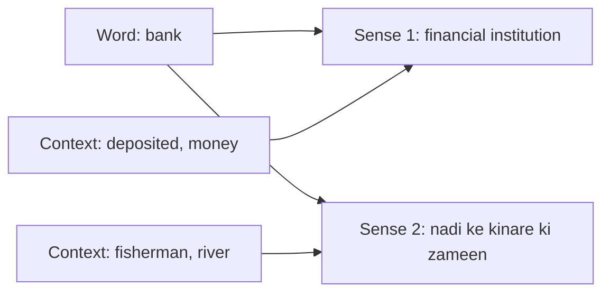
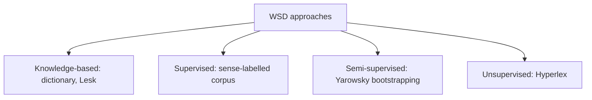
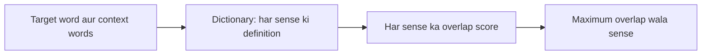
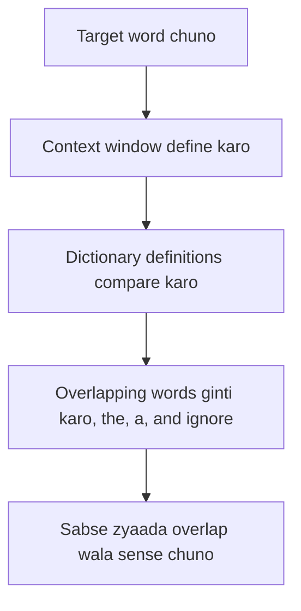
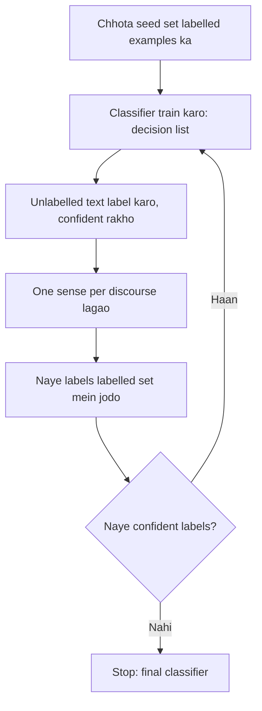
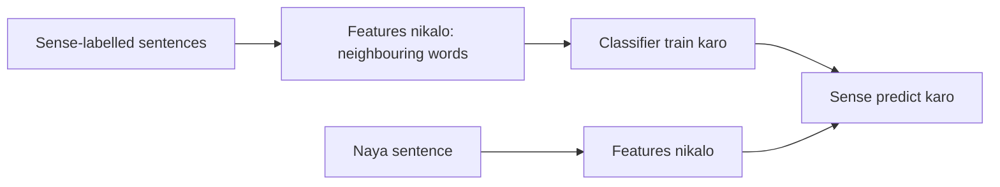

Ye note syllabus <Syl m="4" /> hai: word sense disambiguation. Iske peeche ke lexemes aur relations (homonymy, polysemy) lexical semantics ke note mein hain.

## Pehle basics

- **Sense** word ki ek meaning hai. *Bank* ka ek sense "financial institution" hai aur ek "nadi ke kinare ki zameen".
- Jis word ke ek se zyaada senses hon wo **ambiguous** hai; meaning us context ke saath badalti hai jisme wo use hua. Ek word ki kai meanings se aane wali ambiguity lexical ambiguity kehlati hai. <Cite id="class-nlp-pyq4" loc="p. 5" /> <Cite id="class-nlp-pyq4" loc="p. 6" />
- **Context** ka matlab target word ke aas-paas ke words.

## WSD kya hai?

<Box kind="definition">

**Word Sense Disambiguation (WSD)** us word ki sahi meaning tay karne par focus karta hai jiske kai possible interpretations hain. <Cite id="class-nlp-pyq4" loc="p. 5" />

</Box>

WSD NLP system ko aas-paas ke words analyze karke intended sense pehchanne deta hai, jisse language understanding behtar hoti hai aur ambiguity kam hoti hai. <Cite id="class-nlp-pyq4" loc="p. 5" />

- "She deposited money in the bank." Bank financial institution hai.
- "The fisherman sat on the river bank." Bank nadi ke kinare ki zameen hai. <Cite id="class-nlp-pyq4" loc="p. 5" />

<PYQ id="2024-12-ce/q1a" /> <PYQ id="2024-12/q1d" />

## Dictionary-based (knowledge-based) approach

Knowledge-based approaches dictionaries aur semantic networks jaise lexical resources se word meanings tay karte hain. Lesk algorithm isi approach par kaam karta hai. <Cite id="class-nlp-pyq4" loc="p. 5" />

1. Context words ko candidate senses ki dictionary definitions se compare karo.
2. Context words aur definition words ke beech overlap calculate karo.
3. Maximum overlap score wala sense chuno. <Cite id="class-nlp-pyq4" loc="p. 5" />

Ye maanta hai ki coherent text mein saath use hue words ke semantic relationships unki dictionary definitions mein dikhte hain. **Advantages:** annotated training data nahi chahiye, maujood linguistic knowledge bases use hote hain aur decisions samajhna aasaan hai. <Cite id="class-nlp-pyq4" loc="p. 5" />

<PYQ id="2022-12-ce/q5a" /> <PYQ id="2023-05-ce/q2a" /> <PYQ id="2025-05/q3b" /> <PYQ id="assignment-2/q4c" />

## Lesk's algorithm

Lesk's algorithm ek dictionary-based approach hai jise seminal maana jaata hai; Michael E. Lesk ne ise 1986 mein introduce kiya. Ye is idea par bana hai ki text mein use hue words ek doosre se related hote hain, aur ye relation words aur unki meanings ki definitions mein dikhta hai. Ye maanta hai ki ek neighbourhood (text ke ek hisse) ke words ka theme similar hota hai. <Cite id="class-nlp-pyq4" loc="p. 3" /> Simplified version mein uncertain word ki dictionary definition ko uske neighbourhood ke terms se compare kiya jaata hai. <Cite id="class-nlp-pyq4" loc="p. 3" />

**Basic Lesk algorithm ke steps** <Cite id="class-nlp-pyq4" loc="p. 3" />

1. **Select word:** wo word chuno jiski meaning chahiye, target word.
2. **Define context window:** target word ke aas-paas ke words ka ek group pehchano.
3. **Compare definitions:** target word ki dictionary definitions ko context window ke words ki definitions se compare karo.
4. **Count overlaps:** dono mein common words ginti karo. "the", "a", "and" jaise common words hata do.
5. **Choose most overlapping definition:** target word ki wo definition chuno jiska overlap count sabse zyaada ho. Wahi current context mein sabse likely meaning hai.

<Sum>

<Given>

sentence "I deposited money in the bank", aur *bank* ke do dictionary senses: sense 1 "an institution that keeps money and gives loans"; sense 2 "the land at the side of a river". (Ye chhoti definitions example ke liye banayi gayi hain.)

</Given>

<Find>

Lesk's algorithm ne *bank* ka kaunsa sense chuna.

</Find>

<Steps>

1. Target word: *bank*. Context window: *deposited*, *money*.
2. Definitions se common words hatao (an, the, of, at, that, and, in).
3. Sense 1 mein bachte hain: institution, keeps, money, gives, loans. Context ke saath overlap = word *money*, yaani 1.
4. Sense 2 mein bachte hain: land, side, river. Context ke saath overlap = 0.
5. Sabse zyaada overlap 1 hai, sense 1 ka.

</Steps>

<Answer>

*bank* = financial institution (sense 1).

</Answer>

<Box kind="verify">

Doosra sentence try karo "The fisherman sat on the river bank". Context: *fisherman*, *sat*, *river*. Sense 1 overlap = 0; sense 2 overlap = word *river*, yaani 1, isliye wo nadi ke kinare wala sense chunta hai, jo sahi hai. Alag context par method alag answer deta hai.

</Box>

</Sum>

**Advantages** <Cite id="class-nlp-pyq4" loc="p. 3" />

1. Implement karna simple: samajhna aasaan, kuch lines ka code.
2. Bina bade badlav ke alag-alag contexts par lagu.
3. Naye words par unki dictionary definitions se aasani se generalize hota hai.
4. Non-syntactic: words ki grammatical arrangement par depend nahi karta.
5. Jab word ke senses saaf alag hon to achhi accuracy.

**Disadvantages** <Cite id="class-nlp-pyq4" loc="p. 3" /> <Cite id="class-nlp-pyq4" loc="p. 4" />

1. Jab word ke kai semantically similar senses hon to accuracy kam.
2. Low recall: definitions aur context ke beech overlap bahut kam ho to fail ho sakta hai.
3. Dictionary dependent: results dictionary ki quality aur completeness par depend karte hain.

<PYQ id="2023-12-ce/q4a" /> <PYQ id="2024-05-ce/q4a" /> <PYQ id="2024-12/q5a" /> <PYQ id="assignment-2/q4b" />

## Yarowsky bootstrapping (semi-supervised)

**Definition:** Yarowsky algorithm ek semi-supervised learning approach hai jo mainly WSD ke liye use hota hai. Ye iterative, bootstrapping method hai jo thode se labelled data (seed examples) se bahut saare unlabelled data ko classify karta hai. <Cite id="class-nlp-pyq4" loc="p. 7" />

**Do principles jin par ye tikta hai** <Cite id="class-nlp-pyq4" loc="p. 7" />

1. **One sense per collocation:** jo word kisi khaas aas-paas ke word ke saath aata hai, uski har baar wahi meaning hoti hai. *Example:* "financial" ke saath "bank" strongly financial institution sense batata hai.
2. **One sense per discourse:** ek word ek hi document ya text mein lagbhag ek hi meaning rakhta hai.

**Bootstrapping process** <Cite id="class-nlp-pyq4" loc="p. 7" /> <Cite id="class-nlp-pyq4" loc="p. 8" />

1. **Initial seed examples:** har sense ke kuch haath se labelled examples. *Example:* "plant" ke liye, "manufacturing plant" sense A hai aur "plant life" sense B.
2. **Initial classification:** seeds par ek supervised model (traditionally decision list) train karo. Decision list collocation features, jaise adjacent words, ko is hisaab se rank karti hai ki wo senses ko kitna alag kar paate hain.
3. **Bootstrap labelling:** classifier se baaki unlabelled text ko label karo. Sirf wahi predictions accept karo jahan model bahut confident ho (threshold se upar).
4. **Enforce consistency:** "one sense per discourse" lagao. Agar document mein zyaadatar instances ek sense ke hain, to us document ke saare instances ko wahi sense de do.
5. **Iteration and refinement:** naye confident examples ko seed set mein jodo, retrain karo, aur dohrao. Har round mein classifier zyaada reliable hota hai.
6. **Convergence:** tab ruko jab labelling stable ho jaye aur koi naya example confidently classify na ho, ya kaafi examples label ho jayein.

**Advantages** <Cite id="class-nlp-pyq4" loc="p. 8" />

1. **Kam labelling effort:** sirf chhota haath se labelled seed set chahiye.
2. **Homographs par high accuracy:** coarse senses, jaise plant (factory) versus plant (life), par 95 percent se upar.
3. **Knowledge acquisition automate:** labelled data apne aap badhakar knowledge acquisition bottleneck kam karta hai.
4. **Flexible base learner:** decision list ki jagah doosre supervised learners use ho sakte hain.

**Disadvantages** <Cite id="class-nlp-pyq4" loc="p. 8" /> <Cite id="class-nlp-pyq4" loc="p. 9" />

1. **Domain dependence:** topics ya domains badlein to performance gir sakti hai.
2. **Seeds par sensitive:** kharab seeds errors failate hain.
3. **Mathematical limitations:** ise bahut time tak mathematically achhe se samjha nahi gaya, co-training ke ulte.
4. **Fine-grained senses:** subtle senses par ye homograph-level se kam effective hai.

<PYQ id="2022-12-ce/q3b" /> <PYQ id="assignment-2/q4d" />

## Supervised WSD aur Naive Bayes

*(Class files ye cover nahi karti; wo bas batati hain ki labelled data mehnga hai, yaani "knowledge acquisition bottleneck". <Cite id="class-nlp-pyq4" loc="p. 8" /> Ye standard short version hai.)*

Supervised WSD problem ko classification maanta hai. Aisa corpus jutao jisme har target word apne sense ke saath mark ho, features chuno (aas-paas ke words, word ke theek pehle aur baad ke words, part of speech), classifier train karo aur naye sentences par use karo. Naive Bayes ye chunta hai

$$
\hat{s} = \arg\max_{s} \; P(s) \prod_{j} P(c_j \mid s)
$$

jahan $P(s)$ batata hai ki sense kitni baar aata hai aur $P(c_j \mid s)$ batata hai ki context word $c_j$ us sense ke saath kitni baar aata hai. $P(s_1) = 0.6$, $P(s_2) = 0.4$ aur context words *money* aur *deposit* ke saath finance sense ka score $0.6 \times 0.3 \times 0.2 = 0.036$ hai aur river sense ka $0.4 \times 0.05 \times 0.02 = 0.0004$, isliye finance jeet-ta hai (made-up probabilities illustration ke liye).

<PYQ id="2024-12-ce/q4a" /> <PYQ id="2025-05-ce/q3a" />

## Unsupervised WSD: Hyperlex

*(Class files mein nahi.)* Hyperlex ko labelled data nahi chahiye. Ye target word ke paas aane wale words ka graph banata hai, jo words aksar saath aate hain unhe jodta hai, aur **hubs** dhundhta hai, yaani sabse zyaada jude words. Har hub ek sense ko dikhata hai. Naye sentence ko us hub ka sense milta hai jiske sabse paas uske context words hain.

| Method | Labelled data | Example |
|---|---|---|
| Knowledge-based | None (a dictionary) | Lesk |
| Supervised | Large sense-labelled corpus | Naive Bayes |
| Semi-supervised | Small seed set | Yarowsky |
| Unsupervised | None | Hyperlex |

<PYQ id="2025-05-ce/q6a" />

## Past papers aur class assignment ke questions

- <PYQ id="2024-12-ce/q1a" /> aur <PYQ id="2024-12/q1d" /> WSD kya hai (5 marks)
- <PYQ id="2022-12-ce/q5a" />, <PYQ id="2023-05-ce/q2a" />, <PYQ id="2025-05/q3b" />, <PYQ id="assignment-2/q4c" /> WSD aur dictionary-based approach
- <PYQ id="2023-12-ce/q4a" />, <PYQ id="2024-05-ce/q4a" />, <PYQ id="2024-12/q5a" />, <PYQ id="assignment-2/q4b" /> Lesk's algorithm
- <PYQ id="2022-12-ce/q3b" />, <PYQ id="assignment-2/q4d" /> Yarowsky; <PYQ id="2025-05-ce/q6a" /> Yarowsky aur Hyperlex
- <PYQ id="2024-12-ce/q4a" /> supervised WSD; <PYQ id="2025-05-ce/q3a" /> WSD ki zaroorat aur Naive Bayes
