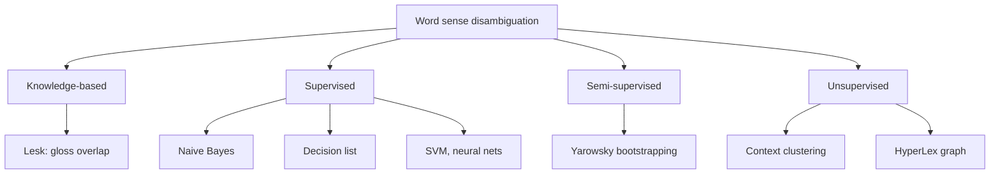
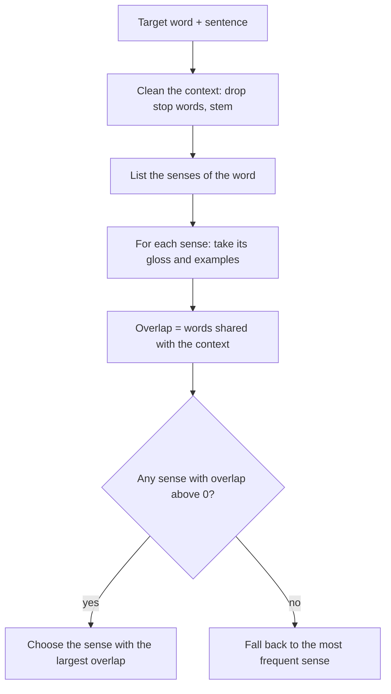
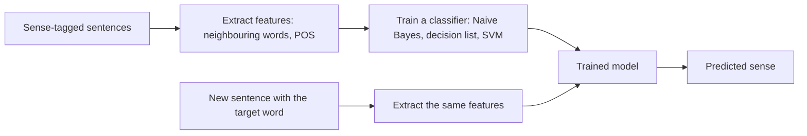
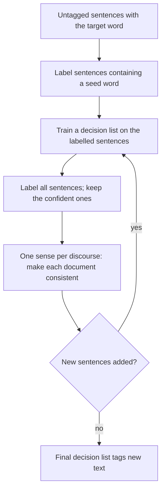
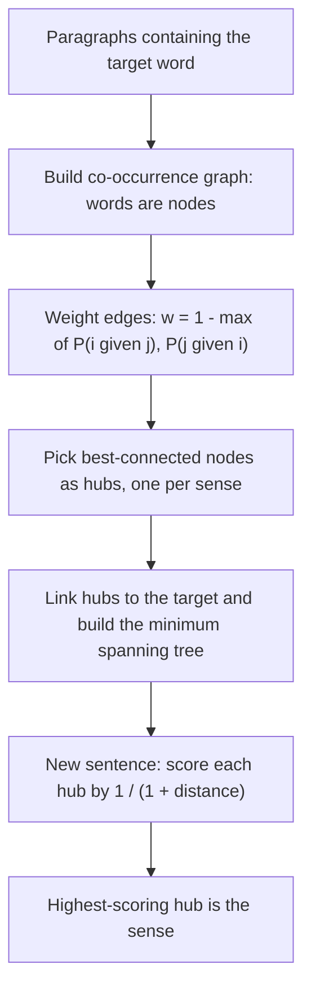

This note is syllabus <Syl m="4" />: 4.5 relations among senses, 4.6 semantic ambiguity, 4.7 word sense disambiguation, 4.8 knowledge-based (Lesk) and supervised (Naive Bayes, decision list) methods, and 4.9 semi-supervised (Yarowsky) and unsupervised (HyperLex) methods. The dictionaries WordNet and BabelNet (4.4) are introduced here only as far as WSD needs them.

## The basics first

- A **word** can be used to mean different things. Each separate meaning is a **sense**. "Bank" has a money sense and a river-side sense. <Cite id="word-sense-disambiguation-slp3-I" loc="§I.1" />
- A **gloss** is the short dictionary definition of one sense, for example "sloping land beside a body of water". <Cite id="word-sense-disambiguation-slp3-I" loc="§I.1.1" />
- **Homonymy:** two unrelated meanings share one spelling (river bank and savings bank). **Polysemy:** one word has several related meanings (the bank as a building and the bank as an organisation). The two shade into each other, and dictionaries do not always agree where to draw the line. <Cite id="word-sense-disambiguation-wiki-homonym" /> <Cite id="ambiguity-challenges-wiki-polysemy" />
- **Synonyms** have nearly the same sense (couch, sofa). A **hyponym** is a more specific word (car is a hyponym of vehicle); the general word is the **hypernym**. <Cite id="word-sense-disambiguation-slp3-I" loc="§I.2" />
- **WordNet** is a free English lexical database. Words that share a sense are grouped in a **synset** (synonym set); each synset has a gloss, and synsets are linked by relations such as hypernym and hyponym. WordNet 3.0 has about 118 thousand nouns, 11 thousand verbs, 22 thousand adjectives and 4 thousand adverbs; the noun *bass* has 8 senses. <Cite id="word-sense-disambiguation-slp3-I" loc="§I.3" /> <Cite id="word-sense-disambiguation-wiki-wordnet" /> <Cite id="word-sense-disambiguation-nltk-wordnet" />
- **BabelNet** links WordNet with Wikipedia and other resources into one multilingual network of senses and named entities, so a sense in English is tied to the same sense in many languages. <Cite id="word-sense-disambiguation-wiki-babelnet" /> <Cite id="word-sense-disambiguation-babelnet" />
- **Semantic ambiguity** (syllabus 4.6) means a word or sentence has more than one meaning even when its grammar is clear. WSD is the standard cure for the word-level case. See the ambiguity note for the other types. <Cite id="word-sense-disambiguation-tp-wsd" />

## What WSD is

<Box kind="definition">

**Word sense disambiguation (WSD)** is the task of deciding which sense of an ambiguous word is meant in a given context. The input is a word in a sentence and a fixed list of its possible senses (the **sense inventory**); the output is the one sense that fits. <Cite id="word-sense-disambiguation-slp3-I" loc="§I.4" /> <Cite id="ambiguity-challenges-wiki-wsd" />

</Box>

**Example.** "I can hear bass sound" means low frequency; "He likes to eat grilled bass" means a fish. The word is the same, only the neighbouring words differ. <Cite id="word-sense-disambiguation-tp-wsd" />

**Everyday analogy.** You hear "I went to the bank" and think "money" or "river" from the rest of the conversation. WSD teaches a computer to use the same clues.

## Why WSD is needed

- **Machine translation:** "bank" must become a different word in Hindi for the money place and for the river side, so the program must pick the sense first. The sense inventory for translation can simply be the set of target-language words. <Cite id="word-sense-disambiguation-slp3-I" loc="§I.4.1" /> <Cite id="word-sense-disambiguation-tp-wsd" />
- **Information retrieval and search:** a search for "bass fishing" should not return music pages.
- **Question answering and text classification:** the right sense decides which fact or topic is meant. <Cite id="word-sense-disambiguation-cam-l98" />
- **Information extraction, lexicography and content analysis** also use it. <Cite id="ambiguity-challenges-navigli2009" loc="§9" />

## How the task is set up

- **Lexical sample task:** a small, pre-chosen list of target words (for example 50 words), each with its senses. Simple supervised classifiers work very well here.
- **All-words task:** every content word in a text must be disambiguated. It is like POS tagging but with a far larger tag set, so training data is sparse. <Cite id="word-sense-disambiguation-slp3-I" loc="§I.4.1" />
- **Training data:** a **sense-tagged corpus** such as **SemCor**, a part of the Brown corpus whose words were hand-tagged with WordNet senses. <Cite id="word-sense-disambiguation-slp3-I" loc="§I.4.1" />
- **Baseline:** always choose the most frequent sense. It is hard to beat: in competitions it scored 51 to 57 percent on fine-grained senses while the best systems reached 59 to 69 percent. Coarse-grained WSD has passed 90 percent. <Cite id="ambiguity-challenges-wiki-wsd" />

## Why WSD is hard

- **Dictionaries disagree** on how many senses a word has and where one ends and the next begins. Dictionaries use many fine senses; for computing, we often group them. <Cite id="word-sense-disambiguation-slp3-I" loc="§I.1.2" /> <Cite id="word-sense-disambiguation-tp-wsd" />
- **Senses are not cleanly separate.** Human annotators agree on the sense only about 70 to 95 percent of the time, so even the "right answer" is partly a matter of opinion. <Cite id="word-sense-disambiguation-vcet-lesk" />
- **Labelled data is costly.** Tagging every word of a large corpus by hand is slow, the **knowledge acquisition bottleneck**. <Cite id="ambiguity-challenges-navigli2009" loc="§10.2" />
- **Context can be subtle:** metaphors, negation and long-distance clues.
- **Different applications need different sense sizes** (translation needs only the distinctions that change the target word).

## Families of WSD methods

<Cite id="word-sense-disambiguation-gfg-wsd" loc="diagram" /> <Cite id="word-sense-disambiguation-cam-l98" /> <Cite id="ambiguity-challenges-navigli2009" loc="§3 to §5" />

## Knowledge-based approach: Lesk's algorithm

**Idea.** Words that appear together in a sentence are about the same topic, so the definition of the right sense should share words with the words around it. The **Lesk algorithm** (Michael Lesk, 1986) counts those shared words and picks the sense with the highest count. It is the standard **dictionary-based** method: it needs a dictionary or WordNet but no labelled sentences. <Cite id="word-sense-disambiguation-wiki-lesk" /> <Cite id="ambiguity-challenges-navigli2009" loc="§5.1" /> <Cite id="word-sense-disambiguation-slp3-I" loc="§I.5.2" />

**Steps (simplified Lesk, one word at a time):**

1. Take the target word and its sentence; the sentence words form the **context**.
2. Remove stop words (the, of, to ...) and, if possible, reduce words to their stem so that tree and trees match.
3. For each sense of the target word, build its **signature**: the words of its gloss (and example sentences, if the dictionary has them).
4. Count the **overlap**: how many words the signature and the context share.
5. Choose the sense with the largest overlap. If all overlaps are zero, fall back to the most frequent sense. <Cite id="word-sense-disambiguation-slp3-I" loc="§I.5.2" /> <Cite id="word-sense-disambiguation-cam-l98" />

<Cite id="word-sense-disambiguation-cam-l98" loc="diagram" /> <Cite id="word-sense-disambiguation-vcet-lesk" />

**Versions.** The **original Lesk** compares the definitions of all the ambiguous words in the sentence with each other (mutual disambiguation), which needs $|Senses(w_1)| \times |Senses(w_2)| \times \dots$ comparisons, a very large number. The **simplified Lesk** (Kilgarriff and Rosenzweig, 2000) compares each word's glosses only with the plain context words and is faster; one study found it clearly more accurate than the original. **Extended Lesk** (Banerjee and Pedersen) also adds the glosses of related senses (hypernyms, hyponyms), so that short glosses are less of a problem. <Cite id="ambiguity-challenges-navigli2009" loc="§5.1" /> <Cite id="word-sense-disambiguation-wiki-lesk" /> <Cite id="word-sense-disambiguation-tp-wsd" />

### Example 1: pine cone (original Lesk)

<Sum>

<Given>

Context: the two words "pine" and "cone". Dictionary definitions:

- PINE 1: kinds of evergreen tree with needle-shaped leaves
- PINE 2: waste away through sorrow or illness
- CONE 1: solid body which narrows to a point
- CONE 2: something of this shape whether solid or hollow
- CONE 3: fruit of certain evergreen trees

Stop words ignored: of, with, to, a, which, or, this, through, whether. Treat "trees" and "tree" as the same word. <Cite id="word-sense-disambiguation-wiki-lesk" /> <Cite id="word-sense-disambiguation-cam-l98" />

</Given>

<Find>

the pair of senses (pine, cone) with the largest overlap.

</Find>

<Steps>

1. Content words of each definition. PINE 1 = \{kinds, evergreen, tree, needle-shaped, leaves\}; PINE 2 = \{waste, away, sorrow, illness\}; CONE 1 = \{solid, body, narrows, point\}; CONE 2 = \{something, shape, solid, hollow\}; CONE 3 = \{fruit, certain, evergreen, tree\}. *Reason: only content words carry meaning.*
2. Compare every PINE sense with every CONE sense (2 × 3 = 6 pairs) and count shared words:

| Pair | Shared words | Overlap |
|---|---|---|
| PINE 1 and CONE 1 | none | 0 |
| PINE 1 and CONE 2 | none | 0 |
| PINE 1 and CONE 3 | evergreen, tree | 2 |
| PINE 2 and CONE 1 | none | 0 |
| PINE 2 and CONE 2 | none | 0 |
| PINE 2 and CONE 3 | none | 0 |

3. The largest overlap is 2, for PINE 1 with CONE 3. *Reason: Lesk keeps the pair with the highest count.*

</Steps>

<Answer>

pine = sense 1 (evergreen tree), cone = sense 3 (fruit of an evergreen tree), overlap 2.

</Answer>

<Box kind="verify">

Recount from the cone side: CONE 1 and CONE 2 share nothing with either pine sense, and CONE 3 shares \{evergreen, tree\} only with PINE 1, so 2 is the maximum. Without stemming, "trees" and "tree" would not match and the best overlap would be 1 (evergreen), but PINE 1 and CONE 3 would still win, so the answer does not change. Common sense agrees: "pine cone" is the cone of a pine tree.

</Box>

</Sum>

### Example 2: bank (simplified Lesk)

<Sum>

<Given>

Sentence: "The bank can guarantee deposits will eventually cover future tuition costs because it invests in adjustable-rate mortgage securities."

WordNet senses of *bank* (gloss plus examples):

- bank 1: a financial institution that accepts deposits and channels the money into lending activities. Examples: "he cashed a check at the bank", "that bank holds the mortgage on my home".
- bank 2: sloping land (especially the slope beside a body of water). Examples: "they pulled the canoe up on the bank", "he sat on the bank of the river and watched the currents".

Ignore stop words and the target word "bank" itself. <Cite id="word-sense-disambiguation-slp3-I" loc="§I.5.2" /> <Cite id="word-sense-disambiguation-cam-l98" />

</Given>

<Find>

the sense of *bank* in the sentence.

</Find>

<Steps>

1. Context words (content words, without "bank"): guarantee, deposits, eventually, cover, future, tuition, costs, invests, adjustable-rate, mortgage, securities. *Reason: these are the clues around the target.*
2. Signature of bank 1: financial, institution, accepts, deposits, channels, money, lending, activities, cashed, check, holds, mortgage, home. Shared with the context: **deposits**, **mortgage**. Overlap = 2.
3. Signature of bank 2: sloping, land, especially, slope, beside, body, water, pulled, canoe, sat, river, watched, currents. Shared with the context: none. Overlap = 0.
4. 2 is larger than 0, so choose bank 1.

</Steps>

<Answer>

bank = sense 1 (financial institution), overlap 2 against 0.

</Answer>

<Box kind="verify">

The sentence talks about deposits, tuition costs and mortgages, which is money talk, so the financial sense is right. Recount the other way: of the 11 context words only "deposits" and "mortgage" appear in any signature, and both are in bank 1, giving 2 and 0.

</Box>

</Sum>

<Box kind="pitfall">

Lesk is fragile. It depends on the exact words in the gloss, so a missing word can flip the answer, and glosses are short. NLTK's `lesk` on "I went to the bank to deposit money" returns the sense "a container (usually with a slot in the top) for keeping money at home" (a piggy bank), not the financial institution, because that gloss happens to share words with the sentence. The original method reached only about 50 to 70 percent accuracy on fine senses, and extended Lesk lifted one test from 18.3 to 34.6 percent. <Cite id="ambiguity-challenges-navigli2009" loc="§5.1" /> <Cite id="word-sense-disambiguation-nltk-wsd" />

</Box>

**Advantages:** no labelled data, easy to explain, works for any word that is in the dictionary. **Disadvantages:** sensitive to gloss wording, short glosses give few overlaps, and it is usually less accurate than supervised methods.

## Supervised approach

**Idea.** Treat WSD as **classification**. Collect sentences in which the target word has already been tagged with its sense, turn each sentence into a list of **features**, train a classifier, and use it on new sentences. This works well for the lexical sample task but needs a lot of hand-tagged data. Statistical WSD of this kind goes back to Brown et al. (1991). <Cite id="word-sense-disambiguation-brown1991" /> <Cite id="word-sense-disambiguation-slp3-I" loc="§I.5.1" /> <Cite id="word-sense-disambiguation-gfg-wsd" /> <Cite id="ambiguity-challenges-navigli2009" loc="§3" />

**Features** used for a target word:

- **Collocation features:** the exact words (and their POS tags) at fixed positions next to the target, such as the word just before and just after.
- **Bag-of-words features:** which words occur anywhere in a window around the target, ignoring order.
- **Syntactic features:** for example the verb that takes the word as its object.
- Newer systems add word embeddings. <Cite id="word-sense-disambiguation-slp3-I" loc="§I.5.1" />

**Steps:** (1) collect a sense-tagged corpus (for example SemCor); (2) extract features for each tagged example; (3) train a classifier (Naive Bayes, decision list, decision tree, SVM, neural network); (4) for a new sentence, extract the same features and let the classifier output the sense. <Cite id="word-sense-disambiguation-gfg-wsd" />

<Cite id="word-sense-disambiguation-gfg-wsd" loc="diagram" />

### Naive Bayes classifier

**Idea.** Pick the sense $s$ that is most probable given the context words $w_1 \dots w_m$. By Bayes' rule, and by the "naive" assumption that the context words are independent of each other once the sense is known, this becomes

$$\hat{s} = \arg\max_{s} \; P(s) \prod_{j=1}^{m} P(w_j \mid s)$$

Here $P(s)$ is the **prior**: how common the sense is in the training data. $P(w_j \mid s)$ is the **likelihood**: how often the word $w_j$ appears in contexts of sense $s$. Both are found by counting. A word never seen with a sense would make the product zero, so we use **add-one (Laplace) smoothing**: $P(w \mid s) = \dfrac{\text{count}(w, s) + 1}{\text{total words in } s \text{ contexts} + |V|}$ with $|V|$ the vocabulary size. <Cite id="ambiguity-challenges-navigli2009" loc="§3.3" /> <Cite id="word-sense-disambiguation-slp3-B" loc="§B.1 and §B.2" /> <Cite id="word-sense-disambiguation-wiki-naive-bayes" />

<Sum>

<Given>

A training set for *bank* has 10 sentences: 6 with the money sense (FIN) and 4 with the river sense (RIV). The vocabulary has 6 context words. Word counts over all contexts of each sense:

| Word | money | loan | account | river | water | fish | Total |
|---|---|---|---|---|---|---|---|
| FIN | 5 | 3 | 4 | 0 | 1 | 0 | 13 |
| RIV | 1 | 0 | 0 | 4 | 3 | 2 | 10 |

New sentence context words: river, water, money. Use add-one smoothing.

</Given>

<Find>

the more probable sense of *bank*.

</Find>

<Steps>

1. Priors: $P(\text{FIN}) = 6/10 = 0.6$, $P(\text{RIV}) = 4/10 = 0.4$. *Reason: share of training sentences.*
2. Smoothed likelihoods for FIN use denominator $13 + 6 = 19$: $P(\text{river}) = 1/19$, $P(\text{water}) = 2/19$, $P(\text{money}) = 6/19$.
3. Score FIN $= 0.6 \times \frac{1}{19} \times \frac{2}{19} \times \frac{6}{19} = 0.6 \times \frac{12}{6859} = 0.6 \times 0.001750 = 0.001050$.
4. Smoothed likelihoods for RIV use denominator $10 + 6 = 16$: $P(\text{river}) = 5/16$, $P(\text{water}) = 4/16$, $P(\text{money}) = 2/16$.
5. Score RIV $= 0.4 \times \frac{5}{16} \times \frac{4}{16} \times \frac{2}{16} = 0.4 \times \frac{40}{4096} = 0.4 \times 0.009766 = 0.003906$.
6. Compare: $0.003906 > 0.001050$, so choose RIV. *Reason: Naive Bayes keeps the sense with the larger score.*

</Steps>

<Answer>

bank = river sense (RIV); scores 0.003906 for RIV against 0.001050 for FIN, about 78.8 percent after normalising.

</Answer>

<Box kind="verify">

Each smoothed row adds to 1: FIN $(6+4+5+1+2+1)/19 = 19/19$ and RIV $(2+1+1+5+4+3)/16 = 16/16$. Normalised, $0.003906 / (0.003906 + 0.001050) = 0.788$. Without smoothing, FIN would score exactly 0 because "river" never occurred with FIN, which would be too harsh; the unsmoothed RIV score is $0.4 \times 0.4 \times 0.3 \times 0.1 = 0.0048$, the same winner. The sentence has two river-ish words (river, water) against one money word, so RIV is sensible.

</Box>

</Sum>

**Advantages:** simple, fast, works well even though the independence assumption is unrealistic. **Disadvantages:** needs tagged data, ignores word order and word-to-word dependence. <Cite id="ambiguity-challenges-navigli2009" loc="§3.3" />

### Decision list

**Idea.** A **decision list** is a ranked list of if-then rules of the form (feature, sense, score). The rules are sorted by score from strongest to weakest. To classify, go down the list and use the **first rule whose feature appears in the sentence**; all later rules are ignored. Yarowsky scored each feature by how lopsided it is between senses, using the log of the ratio of the sense probabilities given the feature. For two senses, this is

$$\text{score}(f) = \left| \log \frac{P(s_1 \mid f)}{P(s_2 \mid f)} \right|$$

where $f$ is the feature (a collocation such as "the word *manufacturing* next to the target"). The larger the score, the more reliable the rule. Counts are smoothed so that a zero does not give an infinite score. <Cite id="word-sense-disambiguation-yarowsky1994" /> <Cite id="ambiguity-challenges-navigli2009" loc="§3.1" />

<Sum>

<Given>

Target word *plant* with two senses: A = factory, B = living thing. Training counts of how often each feature occurred with each sense:

| Feature in the sentence | with A (factory) | with B (living) |
|---|---|---|
| manufacturing | 15 | 0 |
| species | 0 | 7 |
| life | 1 | 11 |
| worker | 7 | 1 |
| water | 3 | 5 |

Use add-one smoothing on both counts and base-2 logs: $\text{score} = |\log_2 \frac{c_A + 1}{c_B + 1}|$. Test sentence: "The plant workers use water from the river."

</Given>

<Find>

the sense of *plant* in the test sentence, using the decision list.

</Find>

<Steps>

1. Score each rule. manufacturing: $\log_2(16/1) = 4$, favours A. species: $\log_2(1/8) = -3$, so 3, favours B. life: $\log_2(2/12) = -\log_2 6 = -2.585$, so 2.585, favours B. worker: $\log_2(8/2) = 2$, favours A. water: $\log_2(4/6) = -0.585$, so 0.585, favours B. *Reason: (c + 1) is the smoothed count, and the sign says which sense wins.*
2. Sort by score, highest first:

| Rank | Feature | Sense | Score |
|---|---|---|---|
| 1 | manufacturing | A | 4 |
| 2 | species | B | 3 |
| 3 | life | B | 2.585 |
| 4 | worker | A | 2 |
| 5 | water | B | 0.585 |

3. Test sentence features: "workers" (the feature *worker*, after reducing to the base word) and *water*. Rule 1 (manufacturing) does not match, rule 2 (species) does not, rule 3 (life) does not, rule 4 (worker) matches. *Reason: go down the list and stop at the first match.*
4. Rule 4 says sense A (factory). The weaker *water* rule (B) is never used.

</Steps>

<Answer>

plant = sense A (factory), decided by the rule "worker", score 2.

</Answer>

<Box kind="verify">

Check the logs by powers of two: $2^4 = 16$, $2^3 = 8$, $2^2 = 4$, $2^{2.585} \approx 6$ and $2^{0.585} \approx 1.5 = 6/4$. The decision is sensible: workers belong to a factory, and the "water" clue is only weakly towards living plants. Had the sentence also contained "species", rule 2 would have fired first and answered B.

</Box>

</Sum>

**Advantages:** easy to read (you can see which rule fired), strong results at the first Senseval contests. **Disadvantages:** uses only one feature per decision and needs tagged data. <Cite id="ambiguity-challenges-navigli2009" loc="§3.1" />

## Semi-supervised approach: Yarowsky's bootstrapping

**Problem.** Tagged data is costly, raw text is cheap. **Bootstrapping** starts from a very small tagged set and lets the program label more data by itself. <Cite id="ambiguity-challenges-navigli2009" loc="§3.8.1" /> <Cite id="word-sense-disambiguation-tp-wsd" />

**Two rules about language that Yarowsky uses:**

1. **One sense per collocation:** nearby words give strong, consistent clues. "Plant" next to "manufacturing" almost always means the factory. <Cite id="word-sense-disambiguation-yarowsky1993" />
2. **One sense per discourse:** inside one document, a word nearly always keeps one sense. If "plant" means factory in paragraph one, it very likely does so in paragraph five. <Cite id="word-sense-disambiguation-gale1992" />

**Steps of the algorithm (Yarowsky 1995):**

1. Collect all sentences containing the target word from a large untagged corpus.
2. Give a few **seed collocations**, one per sense, by hand (for *plant*: "life" for the living sense and "manufacturing" for the factory sense). Sentences that contain a seed get that sense; they form the first labelled set. Most sentences stay unlabelled.
3. Train a **decision list** on the labelled set. It learns new collocations, for example "species" and "animal" for living, "worker" and "assembly" for factory.
4. Apply the decision list to all sentences; add those labelled with high confidence to the labelled set.
5. Apply **one sense per discourse**: if most labelled occurrences in a document have one sense, relabel the rest of that document to match.
6. Repeat steps 3 to 5. Stop when no new sentence can be added. The final decision list is used to tag new text. <Cite id="word-sense-disambiguation-yarowsky1995" /> <Cite id="ambiguity-challenges-navigli2009" loc="§3.8.1" /> <Cite id="word-sense-disambiguation-wiki-yarowsky" />

<Cite id="ambiguity-challenges-navigli2009" loc="Fig. 14" /> <Cite id="word-sense-disambiguation-wiki-yarowsky" />

**Result.** Yarowsky reported accuracy above 96 percent on two-sense words, rivalling supervised methods. Navigli notes that the test was small and binary, so it is not comparable with the later contests. <Cite id="word-sense-disambiguation-yarowsky1995" /> <Cite id="ambiguity-challenges-navigli2009" loc="§3.8.1" />

**Advantages:** needs only seeds and raw text. **Disadvantages:** a wrong early label can spread (error propagation), it is hard to choose the confidence threshold and number of rounds, and the two rules do not hold for every word. <Cite id="ambiguity-challenges-navigli2009" loc="§3.8.1" />

## Unsupervised approach: sense induction and HyperLex

**Idea.** Use no dictionary and no tagged data. Words that occur in similar contexts have similar meanings, so group the contexts of a word; each group is one sense. Because the senses are discovered, not read from a dictionary, this is called **word sense induction** (or discrimination). The groups have no names, only numbers (sense 1, sense 2). <Cite id="word-sense-disambiguation-slp3-I" loc="§I.7" /> <Cite id="word-sense-disambiguation-tp-wsd" />

**Context clustering (the usual way):**

1. For every occurrence of the word, build a **context vector** from the words around it.
2. **Cluster** these vectors into groups; each cluster is a sense.
3. Take the centre (centroid) of each cluster as the **sense vector**.
4. To disambiguate a new occurrence, build its context vector and give it the sense of the nearest sense vector. <Cite id="word-sense-disambiguation-slp3-I" loc="§I.7" />

### HyperLex

**HyperLex** (Véronis, 2004) finds senses with a **co-occurrence graph**: words are nodes, and two words are joined if they occur together in the same paragraph with the target word. <Cite id="ambiguity-challenges-navigli2009" loc="§4.3" />

1. **Build the graph** from paragraphs that contain the target word (for example *barn*).
2. **Weight each edge** by how rarely the two words appear together: $w_{ij} = 1 - \max\{P(w_i \mid w_j),\ P(w_j \mid w_i)\}$, where $P(w_i \mid w_j) = \text{freq}_{ij} / \text{freq}_j$. Words that often occur together get a weight near 0 (close), words that rarely do get a weight near 1 (far). Drop edges above a threshold.
3. **Find hubs:** repeatedly pick the node with the most connections as a **hub**, then rule out its neighbours as hub candidates. Stop when the next hub is too rare. Each hub stands for one sense.
4. **Join the hubs to the target word** with zero-weight edges and compute the **minimum spanning tree** (MST).
5. **Disambiguate:** for a new sentence, for each context word find which hub it is under in the MST and score that hub by $1 / (1 + d)$ with $d$ the distance to the hub. Add the scores over all context words; the hub with the highest total gives the sense. <Cite id="ambiguity-challenges-navigli2009" loc="§4.3" />

<Cite id="ambiguity-challenges-navigli2009" loc="Fig. 16" />

<Sum>

<Given>

In a corpus about the target word *barn*: word pair (milk, cow) occurs together in 30 paragraphs, milk occurs in 60 paragraphs and cow in 40. Word pair (milk, tractor) occurs together in 2 paragraphs, milk in 50 and tractor in 40. Use $w_{ij} = 1 - \max\{P(w_i \mid w_j), P(w_j \mid w_i)\}$ with $P(w_i \mid w_j) = \text{freq}_{ij}/\text{freq}_j$. The numbers are made up for practice.

</Given>

<Find>

the edge weights of (milk, cow) and (milk, tractor).

</Find>

<Steps>

1. (milk, cow): $P(\text{milk} \mid \text{cow}) = 30/40 = 0.75$ and $P(\text{cow} \mid \text{milk}) = 30/60 = 0.50$. The maximum is 0.75, so $w = 1 - 0.75 = 0.25$.
2. (milk, tractor): $P(\text{milk} \mid \text{tractor}) = 2/40 = 0.05$ and $P(\text{tractor} \mid \text{milk}) = 2/50 = 0.04$. The maximum is 0.05, so $w = 1 - 0.05 = 0.95$. *Reason: the formula uses the larger of the two conditional probabilities.*

</Steps>

<Answer>

$w(\text{milk}, \text{cow}) = 0.25$ (close); $w(\text{milk}, \text{tractor}) = 0.95$ (far).

</Answer>

<Box kind="verify">

Check against the meaning: milk and cow often appear together, so their weight should be near 0 and it is 0.25; milk and tractor almost never do, so the weight should be near 1 and it is 0.95. Both weights lie between 0 and 1, as the formula requires. In a graph, milk and cow would be in the same cluster (the dairy sense), the tractor in another.

</Box>

</Sum>

Navigli reports that HyperLex and a PageRank variant, tuned on Senseval-3 nouns, came close to supervised systems. **Advantages:** no labelled data, finds senses missing from dictionaries. **Disadvantages:** the discovered senses must be mapped to dictionary senses before they can be compared, many parameters to tune, and no standard evaluation. <Cite id="ambiguity-challenges-navigli2009" loc="§4.3" /> <Cite id="word-sense-disambiguation-slp3-I" loc="§I.7" />

## Comparison of the four approaches

| Point | Knowledge-based (Lesk) | Supervised (Naive Bayes, decision list) | Semi-supervised (Yarowsky) | Unsupervised (HyperLex, clustering) |
|---|---|---|---|---|
| Needs | dictionary or WordNet | sense-tagged corpus | few seeds + raw text | raw text only |
| Senses come from | dictionary | tagged data | seeds, then learned | discovered from text |
| Accuracy | lowest | highest | close to supervised on simple words | needs mapping to compare |
| Main weakness | depends on gloss wording | cost of tagging | error spreading | unnamed senses |
| Best when | no tagged data, any word | few target words, lots of data | little data | new domain or language |

<Cite id="ambiguity-challenges-navigli2009" loc="§3 to §5" /> <Cite id="word-sense-disambiguation-cam-l98" /> <Cite id="word-sense-disambiguation-tp-wsd" />

## Applications

Machine translation (choose the right target word), search engines, question answering, text classification, information extraction, dictionary making, and the semantic web. Modern systems use contextual embeddings (BERT-like models) to represent each occurrence and compare it with sense embeddings. <Cite id="word-sense-disambiguation-slp3-I" loc="§I.4.2" /> <Cite id="ambiguity-challenges-navigli2009" loc="§9" />

## Exam answers

<Box kind="exam">

**What is WSD? Why is it needed (5 marks):** define (pick the right sense of an ambiguous word from context), the bank or bass example, three needs (translation, search, question answering), why it is hard (dictionaries differ, costly tagged data), and a one-line list of the four method families. <PYQ id="2024-12/q1d" /> <PYQ id="2024-12-ce/q1a" /> <PYQ id="2025-05-ce/q3a" />

**Dictionary-based approach and Lesk's algorithm (10 marks):** define WSD, then the idea (gloss overlap), the five steps, the flowchart, the pine cone sum with the 2 × 3 overlap table, a second example (bank), versions (original, simplified, extended), advantages and disadvantages. <PYQ id="2022-12-ce/q5a" /> <PYQ id="2023-05-ce/q2a" /> <PYQ id="2023-12-ce/q4a" /> <PYQ id="2024-05-ce/q4a" /> <PYQ id="2024-12/q5a" /> <PYQ id="2025-05/q3b" />

**Supervised learning for WSD / Naive Bayes (10 marks):** classification view, features, steps of the pipeline diagram, the Naive Bayes formula with prior and likelihood, a small smoothed example, decision list as a second classifier, advantages (accuracy) and disadvantages (tagged data). <PYQ id="2024-12-ce/q4a" /> <PYQ id="2025-05-ce/q3a" />

**Yarowsky bootstrapping (5 or 10 marks):** the problem (costly tagged data), seeds, the decision-list loop in the diagram, the two rules (one sense per collocation and per discourse), the stopping rule, the result and the limits. For 10 marks add Hyperlex: the co-occurrence graph, edge weight, hubs and spanning tree. <PYQ id="2022-12-ce/q3b" /> <PYQ id="2025-05-ce/q6a" />

</Box>

<Box kind="key">

Memory aid: **Lesk looks in the dictionary, supervised learns from tagged text, Yarowsky grows from seeds, HyperLex finds hubs.** Always say in one line what each one needs: a dictionary, tagged data, a few seeds, or only raw text.

</Box>

## Conclusion

WSD chooses, for an ambiguous word, the sense that fits its context. Knowledge-based methods such as Lesk need only a dictionary but are fragile; supervised methods such as Naive Bayes and decision lists are the most accurate but need tagged data; Yarowsky's bootstrapping reduces that need to a few seeds; and unsupervised methods such as HyperLex find the senses from raw text. In practice, which method is chosen depends on how much labelled data and how good a dictionary are available.
