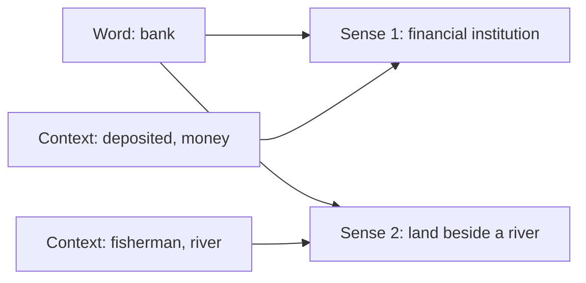
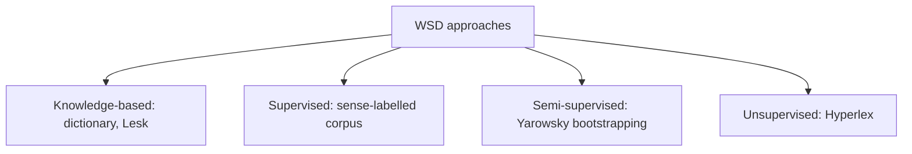
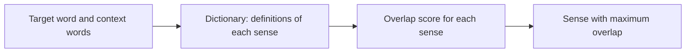
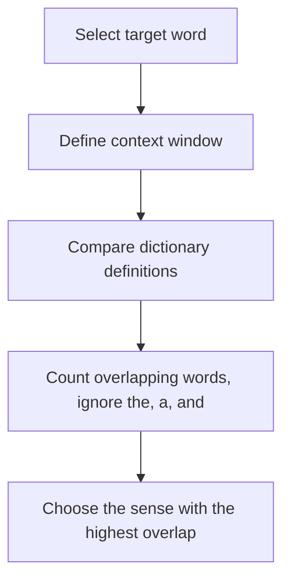
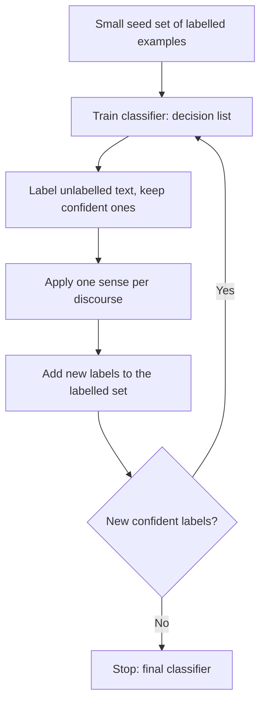
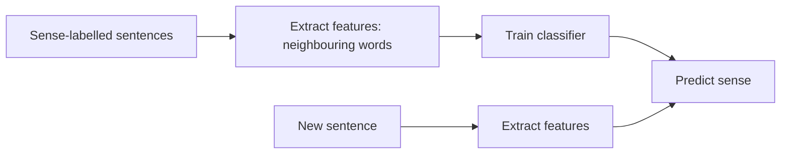

This note is syllabus <Syl m="4" />: word sense disambiguation. The lexemes and relations behind it (homonymy, polysemy) are in the lexical semantics note.

## The basics first

- A **sense** is one meaning of a word. *Bank* has a sense "financial institution" and a sense "land beside a river".
- A word with more than one sense is **ambiguous**; the meaning changes with the context in which it is used. The ambiguity caused by a word with several meanings is called lexical ambiguity. <Cite id="class-nlp-pyq4" loc="p. 5" /> <Cite id="class-nlp-pyq4" loc="p. 6" />
- **Context** means the words around the target word.

## What is WSD?

<Box kind="definition">

**Word Sense Disambiguation (WSD)** focuses on determining the correct meaning of a word when it has multiple possible interpretations. <Cite id="class-nlp-pyq4" loc="p. 5" />

</Box>

WSD lets an NLP system analyze the surrounding words and identify the intended sense, improving language understanding and reducing ambiguity. <Cite id="class-nlp-pyq4" loc="p. 5" />

- "She deposited money in the bank." Bank is a financial institution.
- "The fisherman sat on the river bank." Bank is the land beside a river. <Cite id="class-nlp-pyq4" loc="p. 5" />

<PYQ id="2024-12-ce/q1a" /> <PYQ id="2024-12/q1d" />

## Dictionary-based (knowledge-based) approach

Knowledge-based approaches use lexical resources such as dictionaries and semantic networks to decide word meanings. The Lesk algorithm works on this approach. <Cite id="class-nlp-pyq4" loc="p. 5" />

1. Compare the context words with the dictionary definitions of the candidate senses.
2. Calculate the overlap between the context words and the definition words.
3. Select the sense with the maximum overlap score. <Cite id="class-nlp-pyq4" loc="p. 5" />

It assumes that words used together in coherent text have semantic relationships that show in their dictionary definitions. **Advantages:** it needs no annotated training data, it uses existing linguistic knowledge bases and its decisions are easy to interpret. <Cite id="class-nlp-pyq4" loc="p. 5" />

<PYQ id="2022-12-ce/q5a" /> <PYQ id="2023-05-ce/q2a" /> <PYQ id="2025-05/q3b" /> <PYQ id="assignment-2/q4c" />

## Lesk's algorithm

Lesk's algorithm is a dictionary-based approach considered seminal; Michael E. Lesk introduced it in 1986. It is founded on the idea that words used in a text are related, and that this relationship can be seen in the definitions of the words and their meanings. It assumes that words in a given neighbourhood (a portion of text) have a similar theme. <Cite id="class-nlp-pyq4" loc="p. 3" /> In the simplified version, the dictionary definition of the uncertain word is compared with the terms in its neighbourhood. <Cite id="class-nlp-pyq4" loc="p. 3" />

**Steps of the basic Lesk algorithm** <Cite id="class-nlp-pyq4" loc="p. 3" />

1. **Select word:** choose the word whose meaning you want, the target word.
2. **Define context window:** identify a group of nearby words around the target word.
3. **Compare definitions:** compare the dictionary definitions of the target word with the definitions of the words in the context window.
4. **Count overlaps:** count the words that appear in both. Exclude common words like "the", "a" and "and".
5. **Choose the most overlapping definition:** select the definition of the target word with the highest overlap count. This is the most likely meaning in the current context.

<Sum>

<Given>

the sentence "I deposited money in the bank", and two dictionary senses of *bank*: sense 1 "an institution that keeps money and gives loans"; sense 2 "the land at the side of a river". (These short definitions are made up for the example.)

</Given>

<Find>

the sense of *bank* chosen by Lesk's algorithm.

</Find>

<Steps>

1. Target word: *bank*. Context window: *deposited*, *money*.
2. Remove common words from the definitions (an, the, of, at, that, and, in).
3. Sense 1 keeps: institution, keeps, money, gives, loans. Overlap with the context = the word *money*, so 1.
4. Sense 2 keeps: land, side, river. Overlap with the context = 0.
5. The highest overlap is 1, for sense 1.

</Steps>

<Answer>

*bank* = financial institution (sense 1).

</Answer>

<Box kind="verify">

Try the other sentence "The fisherman sat on the river bank". Context: *fisherman*, *sat*, *river*. Sense 1 overlap = 0; sense 2 overlap = the word *river*, so 1, so it picks the land beside the river, which is right. The method gives different answers for different contexts.

</Box>

</Sum>

**Advantages** <Cite id="class-nlp-pyq4" loc="p. 3" />

1. Simple to implement: easy to understand, a few lines of code.
2. Applicable to different contexts without major modifications.
3. Easily generalizable to new words using their dictionary definitions.
4. Non-syntactic: does not depend on the grammatical arrangement of the words.
5. Good accuracy when the senses of a word are clearly distinguishable.

**Disadvantages** <Cite id="class-nlp-pyq4" loc="p. 3" /> <Cite id="class-nlp-pyq4" loc="p. 4" />

1. Low accuracy when a word has several semantically similar senses.
2. Low recall: it may fail when there is too little overlap between the definitions and the context.
3. Dictionary dependent: results depend on the quality and completeness of the dictionary.

<PYQ id="2023-12-ce/q4a" /> <PYQ id="2024-05-ce/q4a" /> <PYQ id="2024-12/q5a" /> <PYQ id="assignment-2/q4b" />

## Yarowsky bootstrapping (semi-supervised)

**Definition:** the Yarowsky algorithm is a semi-supervised learning approach used mainly for WSD. It is an iterative, bootstrapping method that uses a small set of labelled data (seed examples) to classify a large amount of unlabelled data. <Cite id="class-nlp-pyq4" loc="p. 7" />

**Two principles it relies on** <Cite id="class-nlp-pyq4" loc="p. 7" />

1. **One sense per collocation:** a word that appears with a specific nearby word tends to have the same meaning every time. *Example:* "financial" together with "bank" strongly suggests the financial institution sense.
2. **One sense per discourse:** a word tends to have only one meaning within a single document or text.

**The bootstrapping process** <Cite id="class-nlp-pyq4" loc="p. 7" /> <Cite id="class-nlp-pyq4" loc="p. 8" />

1. **Initial seed examples:** a few hand-labelled examples for each sense. *Example:* for "plant", "manufacturing plant" is sense A and "plant life" is sense B.
2. **Initial classification:** train a supervised model (traditionally a decision list) on the seeds. The decision list ranks collocation features, such as adjacent words, by how well they separate the senses.
3. **Bootstrap labelling:** use the classifier to label the rest of the unlabelled text. Accept only predictions where the model is highly confident (above a threshold).
4. **Enforce consistency:** apply "one sense per discourse". If most instances in a document have one sense, relabel all instances in that document with it.
5. **Iteration and refinement:** add the new confident examples to the seed set, retrain, and repeat. Each round the classifier gets more reliable.
6. **Convergence:** stop when labelling stabilizes and no new examples are classified confidently, or enough examples are labelled.

**Advantages** <Cite id="class-nlp-pyq4" loc="p. 8" />

1. **Reduced labelling effort:** only a small hand-labelled seed set is needed.
2. **High accuracy on homographs:** above 95 percent for coarse senses such as plant (factory) versus plant (life).
3. **Automates knowledge acquisition:** it reduces the knowledge acquisition bottleneck by expanding the labelled data automatically.
4. **Flexible base learner:** other supervised learners can replace the decision list.

**Disadvantages** <Cite id="class-nlp-pyq4" loc="p. 8" /> <Cite id="class-nlp-pyq4" loc="p. 9" />

1. **Domain dependence:** it may suffer when topics or domains vary.
2. **Sensitive to the seeds:** poor seeds spread errors.
3. **Mathematical limitations:** it was not mathematically well understood for a long time, unlike co-training.
4. **Fine-grained senses:** it is less effective for subtle senses than for homograph-level ones.

<PYQ id="2022-12-ce/q3b" /> <PYQ id="assignment-2/q4d" />

## Supervised WSD and Naive Bayes

*(The class files do not cover these; they say only that labelled data is costly, the "knowledge acquisition bottleneck". <Cite id="class-nlp-pyq4" loc="p. 8" /> This is the standard short version.)*

Supervised WSD treats the problem as classification. Collect a corpus where each target word is marked with its sense, choose features (nearby words, the words just before and after, part of speech), train a classifier and use it on new sentences. Naive Bayes chooses

$$
\hat{s} = \arg\max_{s} \; P(s) \prod_{j} P(c_j \mid s)
$$

where $P(s)$ is how often the sense occurs and $P(c_j \mid s)$ is how often the context word $c_j$ appears with that sense. With $P(s_1) = 0.6$, $P(s_2) = 0.4$ and the context words *money* and *deposit*, the finance sense scores $0.6 \times 0.3 \times 0.2 = 0.036$ and the river sense scores $0.4 \times 0.05 \times 0.02 = 0.0004$, so finance wins (made-up probabilities for illustration).

<PYQ id="2024-12-ce/q4a" /> <PYQ id="2025-05-ce/q3a" />

## Unsupervised WSD: Hyperlex

*(Not in the class files.)* Hyperlex needs no labelled data. It builds a graph of the words that appear near the target word, joins words that often occur together, and finds the **hubs**, the most connected words. Each hub stands for one sense. A new sentence gets the sense of the hub its context words are closest to.

| Method | Labelled data | Example |
|---|---|---|
| Knowledge-based | None (a dictionary) | Lesk |
| Supervised | Large sense-labelled corpus | Naive Bayes |
| Semi-supervised | Small seed set | Yarowsky |
| Unsupervised | None | Hyperlex |

<PYQ id="2025-05-ce/q6a" />

## Questions from past papers and the class assignment

- <PYQ id="2024-12-ce/q1a" /> and <PYQ id="2024-12/q1d" /> what is WSD (5 marks)
- <PYQ id="2022-12-ce/q5a" />, <PYQ id="2023-05-ce/q2a" />, <PYQ id="2025-05/q3b" />, <PYQ id="assignment-2/q4c" /> WSD and the dictionary-based approach
- <PYQ id="2023-12-ce/q4a" />, <PYQ id="2024-05-ce/q4a" />, <PYQ id="2024-12/q5a" />, <PYQ id="assignment-2/q4b" /> Lesk's algorithm
- <PYQ id="2022-12-ce/q3b" />, <PYQ id="assignment-2/q4d" /> Yarowsky; <PYQ id="2025-05-ce/q6a" /> Yarowsky and Hyperlex
- <PYQ id="2024-12-ce/q4a" /> supervised WSD; <PYQ id="2025-05-ce/q3a" /> need of WSD and Naive Bayes
