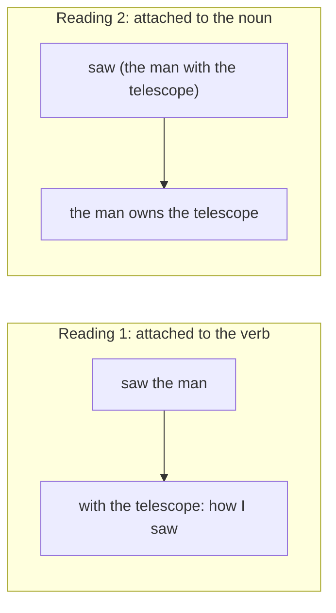

**In simple words:** sentence ambiguous tab hota hai jab use ek se zyada tarike se samjha ja sakta hai. **Lexical ambiguity** mein dikkat ek **word** ki hoti hai jiske kai meaning ya word classes hote hain. **Syntactic ambiguity** mein har word clear hota hai, lekin sentence ka **grammar structure** ek se zyada tarike se ban sakta hai. <Cite id="ambiguity-challenges-gfg-ambiguity" /> <Cite id="ambiguity-challenges-tp-ambiguities" />

**Lexical ambiguity.** Ek word, kai senses ya tags.

- *I went to the bank.* Bank matlab nadi ka kinara ya paise ka office (do meaning, class same: noun).
- *Book a ticket* aur *read a book*: *book* ek jagah verb hai, doosri jagah noun (do word classes).

**Syntactic ambiguity (structural ambiguity).** Ek hi word string, kai parse trees. *I saw the man with the telescope.* Ya to *with the telescope* verb se judta hai (maine telescope se dekha) ya noun phrase se (aadmi ke paas telescope tha). <Cite id="ambiguity-challenges-wiki-synamb" />

| Point | Lexical ambiguity | Syntactic ambiguity |
|---|---|---|
| Source | Ek word, kai meaning ya tags | Ek sentence, kai structures |
| Example | *bank*, *bat*, *book* | *I saw the man with the telescope* |
| Level of NLP | Lexical (words) | Syntactic (grammar) |
| Cured by | POS tagging aur word sense disambiguation | Probabilities ke saath parsing (PCFG) ya context |
| Output problem | Galat sense ya tag | Galat parse tree |

**Conclusion:** lexical ambiguity word ke meaning ke baare mein hai; syntactic ambiguity ye hai ki words ka grouping kaise hua. Machine ko meaning samajhne se pehle dono solve karni padti hain. <Cite id="ambiguity-challenges-slp3" />
