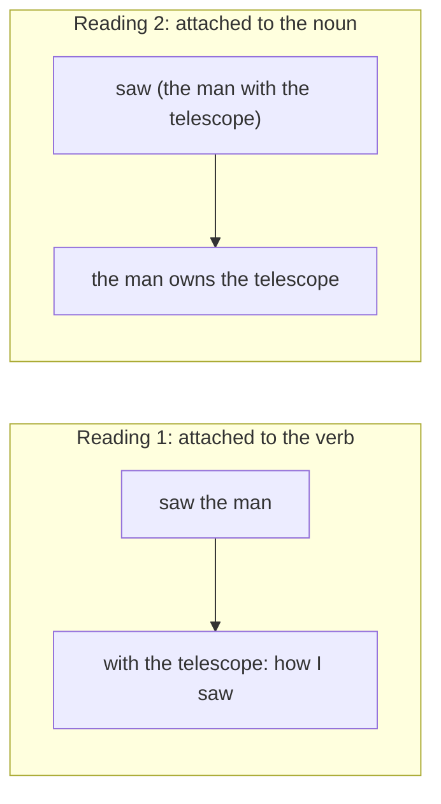

**In simple words:** a sentence is ambiguous when it can be understood in more than one way. In **lexical ambiguity** the trouble is one **word** that has several meanings or word classes. In **syntactic ambiguity** every word is clear, but the **grammar structure** of the sentence can be built in more than one way. <Cite id="ambiguity-challenges-gfg-ambiguity" /> <Cite id="ambiguity-challenges-tp-ambiguities" />

**Lexical ambiguity.** One word, many senses or tags.

- *I went to the bank.* Bank is a river side or a money office (two meanings, same class: noun).
- *Book a ticket* versus *read a book*: *book* is a verb in one and a noun in the other (two word classes).

**Syntactic ambiguity (structural ambiguity).** One word string, many parse trees. *I saw the man with the telescope.* Either the phrase *with the telescope* belongs to the verb (I used a telescope to see) or to the noun phrase (the man has the telescope). <Cite id="ambiguity-challenges-wiki-synamb" />

| Point | Lexical ambiguity | Syntactic ambiguity |
|---|---|---|
| Source | One word with many meanings or tags | One sentence with many structures |
| Example | *bank*, *bat*, *book* | *I saw the man with the telescope* |
| Level of NLP | Lexical (words) | Syntactic (grammar) |
| Cured by | POS tagging and word sense disambiguation | Parsing with probabilities (PCFG) or context |
| Output problem | Wrong sense or tag | Wrong parse tree |

**Conclusion:** lexical ambiguity is about what a word means; syntactic ambiguity is about how the words are grouped. Both must be resolved before a machine can get the meaning. <Cite id="ambiguity-challenges-slp3" />
