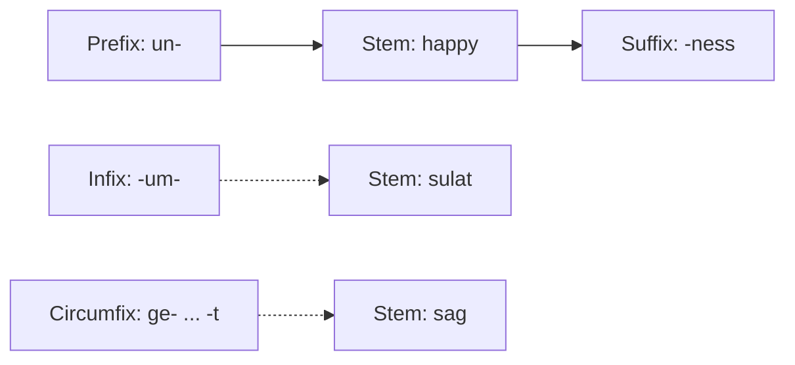

**In simple words:** word chhote pieces se bana hota hai jinhe **morphemes** kehte hain. Main piece **stem** (ya root) hai, jaise *happy*. **Affix** ek chhota bound piece hai jo stem ke saath judkar uska meaning ya grammar badal deta hai. Wo akela word nahi ban sakta. <Cite id="morphology-fst-wiki-affix" /> <Cite id="morphology-fst-tp-word" />

**Definition:** affix ek morpheme hai jo stem se judkar naya word ya word ka naya form banata hai. Example: *unhappiness* mein *un-* aur *-ness* affixes hain aur *happy* stem hai.

**Types of affixes** (kahan lagte hain):

| Type | Kahan lagta hai | Example |
|---|---|---|
| Prefix | Stem se pehle | *un-* + happy = unhappy; *re-* + write = rewrite |
| Suffix | Stem ke baad | walk + *-ed* = walked; kind + *-ness* = kindness |
| Infix | Stem ke andar | Tagalog *sulat* (write) + *-um-* = *sumulat* (wrote); English mein rare |
| Circumfix | Stem ke dono taraf, ek piece pehle aur ek baad mein | German *sagen* se *ge-sag-t* (said) |

English mein mostly prefixes aur suffixes hote hain. Infix aur circumfix doosri languages mein common hain. <Cite id="morphology-fst-jm-ch3-notes" /> <Cite id="morphology-fst-gfg-morph" />

**Kaam ke hisaab se affixes do tarah ke hote hain:** **inflectional** affixes sirf grammar badalte hain aur word class same rakhte hain (*cat* se *cats*, *walk* se *walked*), aur **derivational** affixes naya word banate hain, aksar nayi class ka (*happy* se *happiness*, adjective se noun). <Cite id="morphology-fst-wiki-affix" />

**Conclusion:** affixes stem se jude chhote pieces hain; unka type pata ho to morphological analyser *unhappiness* ko un + happy + ness mein tod sakta hai.
