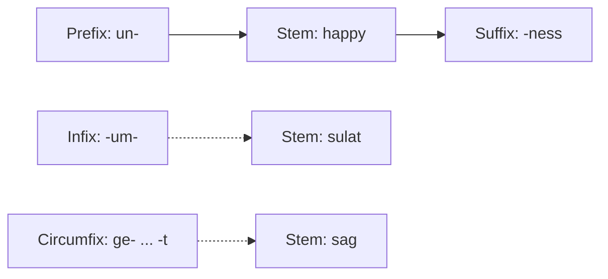

**In simple words:** a word is built from smaller pieces called **morphemes**. The main piece is the **stem** (or root), such as *happy*. An **affix** is a small bound piece added to a stem to change its meaning or its grammar. It cannot stand alone as a word. <Cite id="morphology-fst-wiki-affix" /> <Cite id="morphology-fst-tp-word" />

**Definition:** an affix is a morpheme that is attached to a stem to form a new word or a new form of the word. Example: in *unhappiness*, *un-* and *-ness* are affixes and *happy* is the stem.

**Types of affixes** (by where they attach):

| Type | Where it goes | Example |
|---|---|---|
| Prefix | Before the stem | *un-* + happy = unhappy; *re-* + write = rewrite |
| Suffix | After the stem | walk + *-ed* = walked; kind + *-ness* = kindness |
| Infix | Inside the stem | Tagalog *sulat* (write) + *-um-* = *sumulat* (wrote); rare in English |
| Circumfix | Around the stem, one piece before and one after | German *sagen* to *ge-sag-t* (said) |

English uses mostly prefixes and suffixes. Infixes and circumfixes are common in other languages. <Cite id="morphology-fst-jm-ch3-notes" /> <Cite id="morphology-fst-gfg-morph" />

**By job, affixes are also two kinds:** **inflectional** affixes only change grammar and keep the word class (*cat* to *cats*, *walk* to *walked*), and **derivational** affixes make a new word, often of a new class (*happy* to *happiness*, noun from adjective). <Cite id="morphology-fst-wiki-affix" />

**Conclusion:** affixes are the small pieces added to a stem; knowing their type lets a morphological analyser split a word like *unhappiness* into un + happy + ness.
