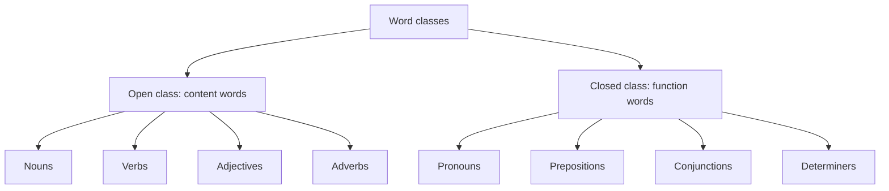

**In simple words:** words ko unke kaam ke hisaab se classes mein baanta jaata hai. Kuch classes mein naye words judte rehte hain (open), baaki ek chhoti fixed list hoti hain (closed). <Cite id="class-nlp-pyq3" loc="p. 1" />

**Open class words:** ye wo words hain jinme naye words aur changes aasani se jud jaate hain. Ye aam taur par content words hote hain jo meaning dete hain, jaise nouns, verbs, adjectives aur adverbs. Language badalne ke saath ye classes badhti rehti hain. <Cite id="class-nlp-pyq3" loc="p. 1" />

- Nouns: book, dog, computer
- Verbs: run, eat, sleep
- Adjectives: big, red, happy
- Adverbs: quickly, softly, beautifully

**Closed class words:** inme naye members aasani se nahi judte. Ye aksar function words hote hain jo grammar ka kaam karte hain aur sentence ke andar structure ka relation dikhate hain. Ye classes kaafi stable hain aur time ke saath mushkil se badalti hain. <Cite id="class-nlp-pyq3" loc="p. 1" />

- Pronouns: he, she, it, they
- Prepositions: on, in, at, with
- Conjunctions: and, but, or, so
- Determiners: the, a, an, some (articles *the, a, an* determiners hi hain)

| Point | Open class | Closed class |
|---|---|---|
| Naye words | Aasani se jude | Lagbhag kabhi nahi |
| Kisam ke words | Content words (meaning) | Function words (grammar) |
| Examples | book, run, big, quickly | he, on, and, the |

**Conclusion:** open class words meaning dete hain aur badhte rehte hain; closed class words grammar ko jodte hain aur fixed rehte hain.
