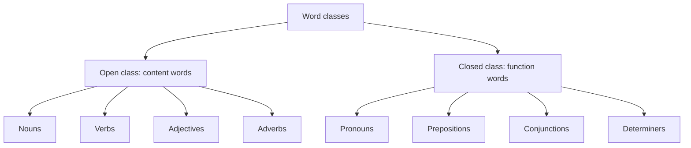

**In simple words:** words are sorted into classes by the job they do. Some classes keep getting new words (open), others are a small fixed list (closed). <Cite id="class-nlp-pyq3" loc="p. 1" />

**Open class words:** words that readily accept new vocabulary additions and changes. They are typically content words that convey meaning, such as nouns, verbs, adjectives and adverbs. These classes are open to expansion and innovation as languages evolve. <Cite id="class-nlp-pyq3" loc="p. 1" />

- Nouns: book, dog, computer
- Verbs: run, eat, sleep
- Adjectives: big, red, happy
- Adverbs: quickly, softly, beautifully

**Closed class words:** words that do not readily accept new members. They are often function words that serve grammatical purposes and show structural relationships within sentences. These classes are relatively stable and resistant to change over time. <Cite id="class-nlp-pyq3" loc="p. 1" />

- Pronouns: he, she, it, they
- Prepositions: on, in, at, with
- Conjunctions: and, but, or, so
- Determiners: the, a, an, some (the articles *the, a, an* are determiners)

| Point | Open class | Closed class |
|---|---|---|
| New words | Easily added | Hardly ever added |
| Kind of word | Content words (meaning) | Function words (grammar) |
| Examples | book, run, big, quickly | he, on, and, the |

**Conclusion:** open class words carry the meaning and keep growing; closed class words hold the grammar together and stay fixed.
