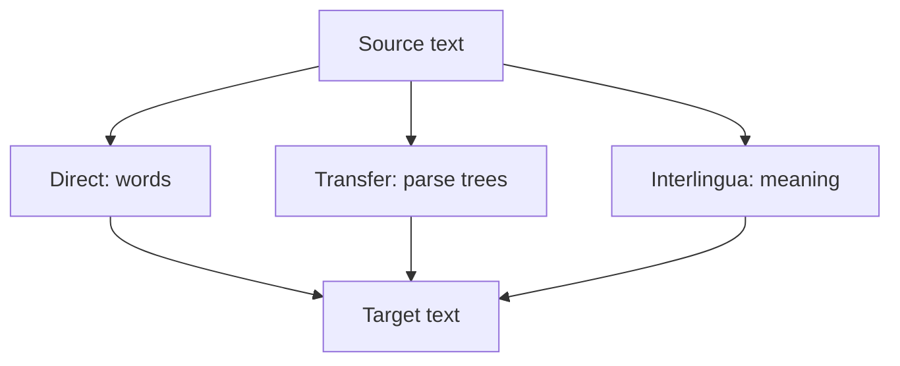

**In simple words:** rule-based machine translation (RBMT) source language ke text ko target language mein **hand-written linguistic rules** aur **dictionaries** se translate karta hai, data se seekhi statistics se nahi. Experts dono languages ke grammar rules aur ek bilingual dictionary likhte hain, aur program unhe apply karta hai. <Cite id="nlp-applications-wiki-rbmt" /> <Cite id="nlp-applications-gfg-mt" />

**RBMT system ke parts:** bilingual dictionary (word se word), source language ke grammar rules (analyse karne ke liye), target language ke grammar rules (generate karne ke liye) aur transfer rules (dono ke beech structure kaise badalta hai).

**RBMT ke teen kinds,** analysis ki depth badhne ke order mein:

1. **Direct:** har word dictionary mein dhundo, phir thoda reorder karo. Fast lekin crude.
2. **Transfer:** source ko parse karo, parse tree ko transfer rules se badlo, phir naye tree se target words generate karo.
3. **Interlingua:** source ko language-free meaning form mein badlo aur usse target generate karo. Har language ke liye sirf ek analyser aur ek generator chahiye. <Cite id="nlp-applications-slp3-13" />

**Example:** English *I eat rice* se Hindi *main chawal khata hoon*. Word order subject-verb-object se subject-object-verb ho jaata hai. Ek transfer rule verb aur object swap karta hai.

**Advantages:** output predictable, parallel corpus nahi chahiye, error ko rule tak trace kar sakte hain. **Disadvantages:** rules haath se likhna bahut costly, sab exceptions aur ambiguity cover karna mushkil, brittle, aur fluency kam. Statistical aur neural translation ne ise zyada tar replace kar diya hai. <Cite id="ambiguity-challenges-wiki-mt" />
