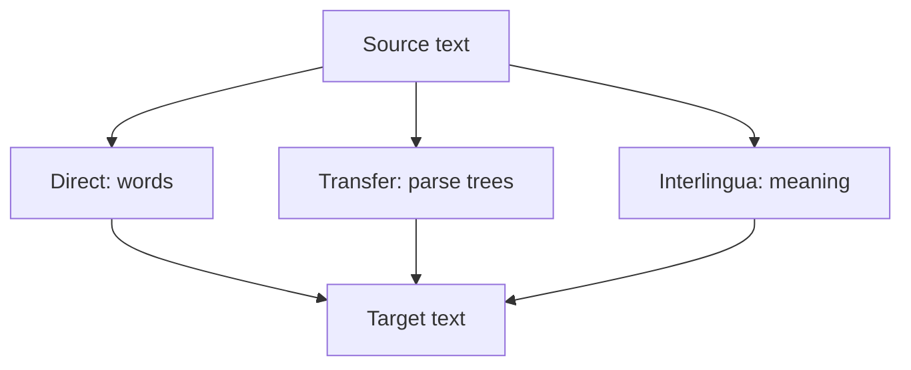

**In simple words:** rule-based machine translation (RBMT) translates text from a source language to a target language using **hand-written linguistic rules** and **dictionaries**, not statistics learned from data. Experts write grammar rules for both languages and a bilingual dictionary, and the program applies them. <Cite id="nlp-applications-wiki-rbmt" /> <Cite id="nlp-applications-gfg-mt" />

**Parts of an RBMT system:** a bilingual dictionary (word to word), grammar rules of the source language (to analyse), grammar rules of the target language (to generate) and transfer rules (how structure changes between the two).

**Three kinds of RBMT,** in rising depth of analysis:

1. **Direct:** look up each word in the dictionary, then reorder a little. Quick but crude.
2. **Transfer:** parse the source, convert the parse tree by transfer rules, then generate target words from the new tree.
3. **Interlingua:** convert the source into a language-free meaning form and generate the target from it. Needs only one analyser and one generator per language. <Cite id="nlp-applications-slp3-13" />

**Example:** English *I eat rice* to Hindi *main chawal khata hoon*. Word order changes from subject-verb-object to subject-object-verb. A transfer rule swaps verb and object.

**Advantages:** predictable output, no parallel corpus needed, errors are traceable to a rule. **Disadvantages:** very costly to write rules by hand, hard to cover all exceptions and ambiguity, brittle, and poor fluency. Statistical and neural translation have mostly replaced it. <Cite id="ambiguity-challenges-wiki-mt" />
