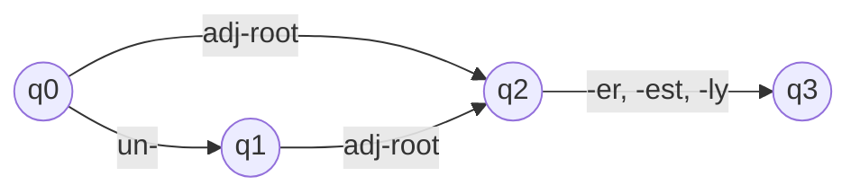
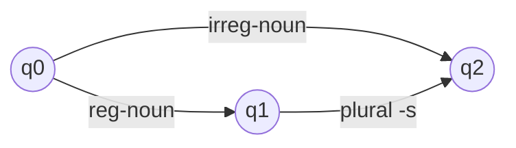

**In simple words:** morphological analysis word ko uske parts (stem aur affixes) mein todta hai, jaise *walked* ko walk + ed mein. **Finite state automaton (FSA)** ek chhoti machine hai jo word ko piece-by-piece padhti hai aur kehti hai "valid word" ya "not a word". Ye **word-building rules** (morphotactics) check karne ka tool hai. <Cite id="morphology-fst-gfg-fa" /> <Cite id="morphology-fst-wiki-parsing" />

**FSA kya hai.** Ismein **states** ka set, ek start state, ek ya zyada final (accepting) states, input symbols ka alphabet aur **transitions** (arrows) hote hain. Ye input left to right padhti hai aur arrows pe chalti hai. Agar final state pe khatam ho to word **accepted**; agar atak jaye ya kahin aur khatam ho to **rejected**. FSAs exactly **regular languages** ko describe karte hain. <Cite id="morphology-fst-wiki-fsm" />

**Ye kyun zaroori hai.** English har word form ki list nahi bana sakti (hazaaron verbs ke liye *walk, walks, walked, walking*). Words ek pattern follow karte hain: pehle stem, phir affixes fixed order mein. FSA pattern ek baar store karta hai aur us kind ke saare words cover karta hai. <Cite id="morphology-fst-jm-ch3-notes" />

**Kaise use hota hai, step by step:**

1. **Lexicon** banao: stems ki lists class ke hisaab se (regular noun, irregular noun, regular verb stem ...).
2. Ek FSA draw karo jiske arrows ye classes aur allowed affixes hain.
3. Word feed karo. Accepted matlab wo rules se bana hai.
4. Path pieces dikhata hai, isliye word stem aur affix mein split ho jaata hai.

Ye *happy*, *unhappy*, *happier*, *unhappier*, *clearly* accept karta hai aur *happyun* aur *unun-happy* reject karta hai. <Cite id="morphology-fst-jm-ch3-notes" />

Ye *cat*, *cats*, *mice* accept karta hai; *mices* reject karta hai.

**FSA ki limits.**

- Ye sirf **recognise** karta hai (yes ya no); ye analysis output nahi deta jaise *cat + N + PL*. Uske liye **finite state transducer (FST)** chahiye, yaani har arrow pe output wala FSA.
- Ye **spelling changes** apply nahi kar sakta (*happy + er* se *happier*, *fox + s* se *foxes*). Spelling rules wale FSTs ye handle karte hain.
- Ek lumped root class ke saath ye zyada words accept kar leta hai, isliye roots ko classes mein baantna padta hai.

**Conclusion:** FSA morphology ka basic checker hai; FST tak badhane par ye full analysis aur generation deta hai. <Cite id="morphology-fst-tp-word" />
