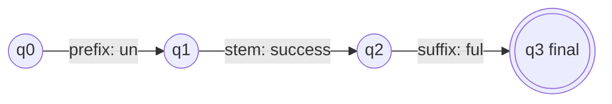

**In simple words:** FSA ek chhoti machine hai jo word ke parts ek-ek karke padhti hai aur batati hai ki wo valid word banate hain ya nahi.

**Definition:** an FSA comprises a finite set of states (Q) which accepts a finite set of inputs (Sigma). Iske parts: Q (states), Sigma (inputs), delta (transition function Q x Sigma to Q), q0 (start state) aur F (final state). <Cite id="class-nlp-m2" loc="p. 4" />

**Morphological analysis mein role:** FSA morphemes se valid words banane ke rules represent karta hai. States word formation ke stages hain; transitions possible stems, prefixes, suffixes aur grammatical features hain; aur automaton check karta hai ki morphemes ki sequence valid word banati hai ya nahi. <Cite id="class-nlp-pyq2" loc="p. 6" />

**Example:** cats ka structure cat + Noun + Plural hai. <Cite id="class-nlp-pyq2" loc="p. 6" />

**Roles** <Cite id="class-nlp-pyq2" loc="p. 6" />

- Valid morphological rules aur word structures represent karta hai.
- Stems, affixes aur grammatical features pehchaanne mein madad karta hai.
- Check karta hai ki word valid morphological patterns follow karta hai ya nahi.
- Analysis aur word generation support karta hai; efficient aur rule-based, rich inflection wali languages ke liye achha.

**Limit:** FSA sirf accept ya reject karta hai; analysis (cats se cat + N + Pl) nikalne ke liye finite state transducer use hota hai.

**Conclusion:** FSA morphological analysis ka checking part hai.
