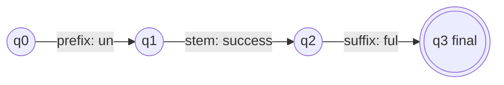

**In simple words:** an FSA is a small machine that reads the parts of a word one by one and says whether they make a valid word.

**Definition:** an FSA comprises a finite set of states (Q) which accepts a finite set of inputs (Sigma). Its parts are Q (states), Sigma (inputs), delta (transition function Q x Sigma to Q), q0 (start state) and F (final state). <Cite id="class-nlp-m2" loc="p. 4" />

**Role in morphological analysis:** FSA represents the rules for forming valid words from their morphemes. The states are the stages of word formation; the transitions are the possible stems, prefixes, suffixes and grammatical features; and the automaton checks whether a sequence of morphemes forms a valid word. <Cite id="class-nlp-pyq2" loc="p. 6" />

**Example:** cats has the structure cat + Noun + Plural. <Cite id="class-nlp-pyq2" loc="p. 6" />

**Roles** <Cite id="class-nlp-pyq2" loc="p. 6" />

- Represents valid morphological rules and word structures.
- Helps identify stems, affixes and grammatical features.
- Checks whether a word follows valid morphological patterns.
- Supports analysis and word generation; efficient and rule-based, good for languages with rich inflection.

**Limit:** an FSA only accepts or rejects; to produce the analysis (cats to cat + N + Pl) a finite state transducer is used.

**Conclusion:** the FSA is the checking part of morphological analysis.
