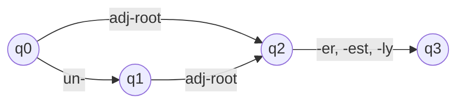
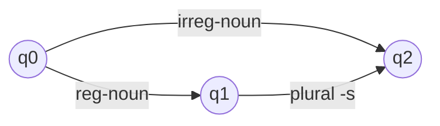

**In simple words:** morphological analysis splits a word into its parts (stem and affixes), for example *walked* into walk + ed. A **finite state automaton (FSA)** is a tiny machine that reads a word piece by piece and says "valid word" or "not a word". It is the tool that checks the **word-building rules** (morphotactics). <Cite id="morphology-fst-gfg-fa" /> <Cite id="morphology-fst-wiki-parsing" />

**What an FSA is.** It has a set of **states**, a start state, one or more final (accepting) states, an alphabet of input symbols and **transitions** (arrows). It reads input left to right and moves along arrows. If it ends in a final state the word is **accepted**; if it gets stuck or ends elsewhere it is **rejected**. FSAs describe exactly the **regular languages**. <Cite id="morphology-fst-wiki-fsm" />

**Why it is needed.** English cannot list every word form (*walk, walks, walked, walking* for each of thousands of verbs). Words follow a pattern: stem first, then affixes in a fixed order. An FSA stores the pattern once and covers all words of that kind. <Cite id="morphology-fst-jm-ch3-notes" />

**How it is used, step by step:**

1. Make a **lexicon**: lists of stems grouped by class (regular noun, irregular noun, regular verb stem ...).
2. Draw an FSA whose arrows are these classes and the allowed affixes.
3. Feed the word in. Accepted means it is built by the rules.
4. The path shows the pieces, so the word is split into stem and affix.

It accepts *happy*, *unhappy*, *happier*, *unhappier*, *clearly* and rejects *happyun* and *unun-happy*. <Cite id="morphology-fst-jm-ch3-notes" />

It accepts *cat*, *cats*, *mice*; it rejects *mices*.

**Limits of an FSA.**

- It only **recognises** (yes or no); it does not output the analysis such as *cat + N + PL*. That needs a **finite state transducer (FST)**, an FSA with an output on each arrow.
- It cannot apply **spelling changes** (*happy + er* gives *happier*, *fox + s* gives *foxes*). FSTs with spelling rules handle these.
- With one lumped root class it over-accepts, so roots must be divided into classes.

**Conclusion:** the FSA is the basic checker of morphology; extended to an FST it gives full analysis and generation. <Cite id="morphology-fst-tp-word" />
