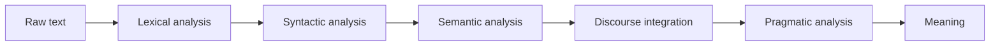

**In simple words:** machine ek jump mein sentence nahi samajh sakti. NLP ye **stages** mein karta hai, aur har stage pichhle stage ka output use karta hai. <Cite id="nlp-introduction-gfg-phases" /> <Cite id="nlp-introduction-tp-nlp" />

**Stages:**

1. **Lexical (morphological) analysis.** Text ko sentences aur words (tokens) mein todo aur words ko stems aur affixes mein todo. *Dogs* se dog + s.
2. **Syntactic analysis (parsing).** Grammar check karo aur structure (parse tree) banao. Ye *Bought Ravi a bat the* ko reject karta hai.
3. **Semantic analysis.** Sentence ka meaning nikalo aur sahi word senses chuno. Yahan *bat* matlab cricket bat.
4. **Discourse integration.** Ek sentence ka meaning pichhle sentences pe depend karta hai. *He* ko *Ravi* se joda jaata hai.
5. **Pragmatic analysis.** Situation aur speaker ka purpose use karo. *Can you pass the salt?* ek request hai, ability ke baare mein sawal nahi.

**Example.** Text: *Ravi bought a bat. He liked it.*

| Stage | Example ke saath kya hota hai |
|---|---|
| Lexical | Tokens: Ravi, bought (buy + ed), a, bat, ".", He, liked (like + ed), it |
| Syntactic | [S [NP Ravi] [VP bought [NP a bat]]] |
| Semantic | *bat* cricket ka tool hai (ya janwar); Ravi buyer hai, bat kharidi gayi cheez |
| Discourse | *He* matlab Ravi; *it* matlab bat |
| Pragmatic | Ravi apni kharidari se khush hai; "Good for you" jaisa reply fit hota hai |

**Note:** real systems stages ko mix ya repeat kar sakte hain, aur kuch saare stages use nahi karte. Ambiguity ki wajah se koi stage fail ho sakta hai, jaise *bat* ke liye semantic stage pe. <Cite id="nlp-introduction-ibm-nlp" />

**Conclusion:** stages text ko characters se words, grammar, meaning, context aur intention tak is order mein le jaate hain. <Cite id="nlp-introduction-slp3" />
