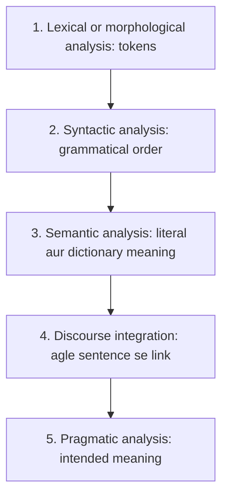

**In simple words:** NLP computer ko human language samajhne aur use karne deta hai. Ek sentence paanch stages se guzarta hai, uske words se lekar speaker asal mein kya chahta hai tak.

**Definition:** Natural Language Processing is a branch of AI that focuses on interaction between computers and humans. Examples: Alexa, Siri, ChatGPT. <Cite id="class-nlp-m1" loc="p. 1" />

**Generic NLP system (process):** input Automatic Speech Recognition mein jaata hai, phir NLU (Natural Language Understanding), phir NLG (Natural Language Generation), phir output. <Cite id="class-nlp-m1" loc="p. 1" />

**Stages, teacher ke examples ke saath** <Cite id="class-nlp-m1" loc="p. 1" /> <Cite id="class-nlp-m1" loc="p. 2" />

1. **Lexical or morphological analysis:** ye sentence ko chunks ya tokens mein baantta hai. "The cat is running" ban jaata hai The | cat | is | running.
2. **Syntactic analysis:** grammar aur structure check hote hain, yaani words grammatically proper order mein hone chahiye. "The dog chased the ball" sahi hai; "The chased ball the dog" galat hai.
3. **Semantic analysis:** ye literal aur dictionary meaning check karta hai. "The apple ate the boy" galat hai kyunki apple kha nahi sakta; "The boy ate the apple" sahi hai.
4. **Discourse integration:** ek sentence agle sentence se kaise related hai. "John wants to read a book. He picked it up." (He matlab John, it matlab book.) <Cite id="class-nlp-asol" loc="p. 1" />
5. **Pragmatic analysis:** intended meaning. "I want to buy apple" (fruit ya phone?); "It's freezing out here" (asli wish heater on karne ki ho sakti hai).

**Conclusion:** pehle teen stages ek sentence ke andar kaam karte hain, aakhri do sentences ke beech links aur speaker ki intention dekhte hain.
