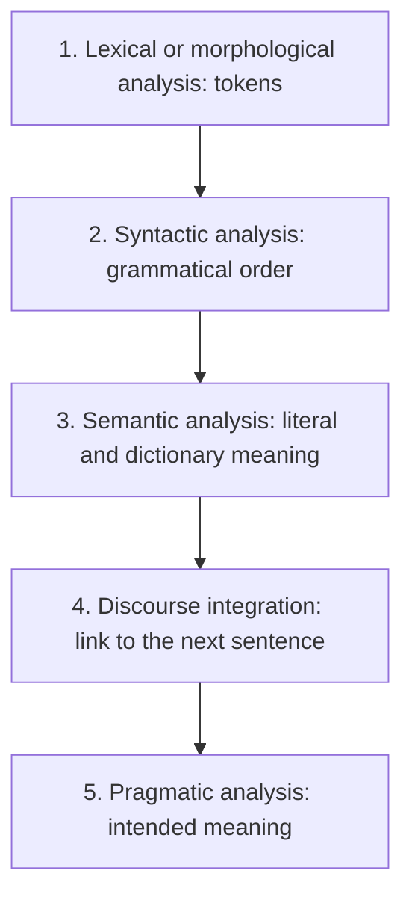

**In simple words:** NLP lets a computer understand and use human language. A sentence passes through five stages, from its words to what the speaker really wants.

**Definition:** Natural Language Processing is a branch of AI that focuses on interaction between computers and humans. Examples: Alexa, Siri, ChatGPT. <Cite id="class-nlp-m1" loc="p. 1" />

**Generic NLP system (the process):** input goes to Automatic Speech Recognition, then to NLU (Natural Language Understanding), then to NLG (Natural Language Generation), then output. <Cite id="class-nlp-m1" loc="p. 1" />

**The stages, with the teacher's examples** <Cite id="class-nlp-m1" loc="p. 1" /> <Cite id="class-nlp-m1" loc="p. 2" />

1. **Lexical or morphological analysis:** it divides the sentence into chunks or tokens. "The cat is running" becomes The | cat | is | running.
2. **Syntactic analysis:** grammar and structure are checked, so the words must be in a grammatically proper order. "The dog chased the ball" is right; "The chased ball the dog" is wrong.
3. **Semantic analysis:** it checks the literal and dictionary meaning. "The apple ate the boy" is wrong because an apple cannot eat; "The boy ate the apple" is right.
4. **Discourse integration:** how a sentence relates to the immediately next sentence. "John wants to read a book. He picked it up." (He is John, it is the book.) <Cite id="class-nlp-asol" loc="p. 1" />
5. **Pragmatic analysis:** the intended meaning. "I want to buy apple" (fruit or phone?); "It's freezing out here" (the real wish may be to turn on the heater).

**Conclusion:** the first three stages work inside one sentence, the last two look at links between sentences and at the speaker's intention.
