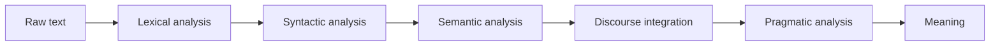

**In simple words:** a machine cannot understand a sentence in one jump. NLP does it in **stages**, and each stage uses the output of the one before. <Cite id="nlp-introduction-gfg-phases" /> <Cite id="nlp-introduction-tp-nlp" />

**The stages:**

1. **Lexical (morphological) analysis.** Split the text into sentences and words (tokens) and break words into stems and affixes. *Dogs* gives dog + s.
2. **Syntactic analysis (parsing).** Check the grammar and build the structure (a parse tree). It rejects *Bought Ravi a bat the*.
3. **Semantic analysis.** Find the meaning of the sentence and pick the right word senses. *bat* here means a cricket bat.
4. **Discourse integration.** Meaning of a sentence depends on the sentences before it. *He* is linked to *Ravi*.
5. **Pragmatic analysis.** Use the situation and the speaker's purpose. *Can you pass the salt?* is a request, not a question about ability.

**Example.** Text: *Ravi bought a bat. He liked it.*

| Stage | What happens to the example |
|---|---|
| Lexical | Tokens: Ravi, bought (buy + ed), a, bat, ".", He, liked (like + ed), it |
| Syntactic | [S [NP Ravi] [VP bought [NP a bat]]] |
| Semantic | *bat* is the cricket tool (or the animal); Ravi is the buyer, bat is the thing bought |
| Discourse | *He* is Ravi; *it* is the bat |
| Pragmatic | Ravi is pleased with his purchase; a reply like "Good for you" fits |

**Note:** real systems may mix or repeat the stages, and some do not use all of them. A stage can fail because of ambiguity, for example at the semantic stage for *bat*. <Cite id="nlp-introduction-ibm-nlp" />

**Conclusion:** the stages take text from characters to words, grammar, meaning, context and intention, in that order. <Cite id="nlp-introduction-slp3" />
