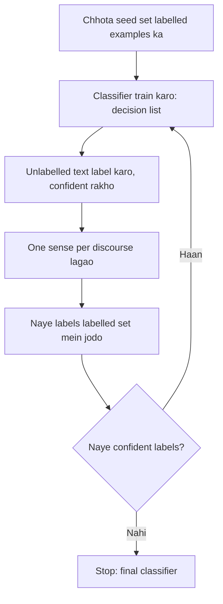

**In simple words:** thode labelled examples se shuru karo, computer ko khud aur label karne do, aur dohrao. <Cite id="class-nlp-pyq4" loc="p. 7" />

**Definition:** Yarowsky algorithm ek semi-supervised learning approach hai jo mainly WSD ke liye use hota hai. Ye iterative, bootstrapping method hai jo thode se labelled data (seed examples) se bahut saare unlabelled data ko classify karta hai. <Cite id="class-nlp-pyq4" loc="p. 7" />

**Do principles jin par ye tikta hai** <Cite id="class-nlp-pyq4" loc="p. 7" />

1. **One sense per collocation:** jo word kisi khaas aas-paas ke word ke saath aata hai, uski har baar wahi meaning hoti hai. *Example:* "financial" ke saath "bank" strongly financial institution sense batata hai.
2. **One sense per discourse:** ek word ek hi document ya text mein lagbhag ek hi meaning rakhta hai.

**Process:** <Cite id="class-nlp-pyq4" loc="p. 7" /> <Cite id="class-nlp-pyq4" loc="p. 8" /> (1) har sense ke kuch seed examples haath se label karo; (2) un par decision-list classifier train karo; (3) unlabelled text ko label karo, sirf confident predictions rakho; (4) one sense per discourse lagao; (5) naye labels jodkar retrain karo; (6) jab koi naya confident label na mile to ruko.

**Advantage:** sirf chhota labelled seed set chahiye. **Disadvantage:** kharab seeds errors failate hain. <Cite id="class-nlp-pyq4" loc="p. 8" />

**Conclusion:** Yarowsky bootstrapping chhote seed set se bada corpus label karta hai.
