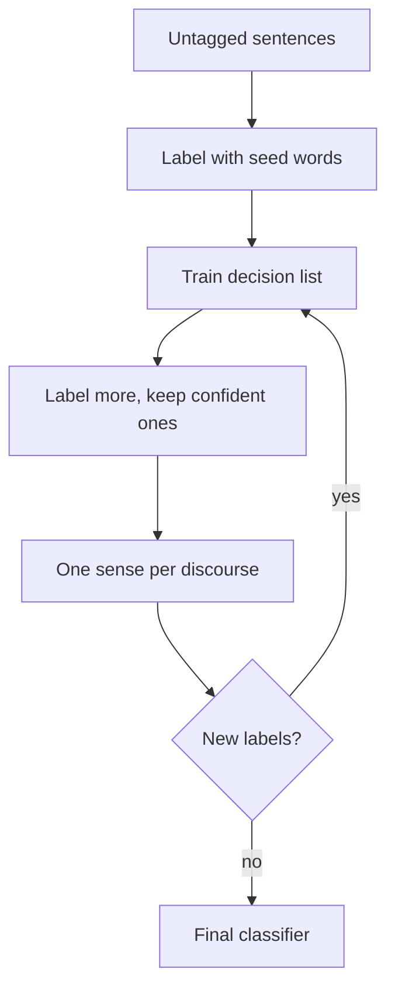

**In simple words:** sentences ko haath se word senses ke saath tag karna slow aur costly hai, lekin plain text sasta hai. **Yarowsky's bootstrapping** (1995) har sense ke liye **kuch seed words** se shuru karta hai aur program khud aur sentences label karta jaata hai. Ye **semi-supervised** hai: thoda labelled data plus bahut saara unlabelled data. <Cite id="word-sense-disambiguation-yarowsky1995" /> <Cite id="word-sense-disambiguation-wiki-yarowsky" />

**Do ideas jin pe ye depend karta hai:**

1. **One sense per collocation:** paas ka word aksar ek hi sense ki taraf ishara karta hai (*plant* ke paas *manufacturing* matlab factory).
2. **One sense per discourse:** ek document mein word ek hi sense rakhta hai.

**Steps** (example word *plant*, senses: living ya factory):

1. Untagged text se *plant* wale saare sentences collect karo.
2. Har sense ke liye ek seed do: living ke liye *life*, factory ke liye *manufacturing*. Seed wale sentences ko wo label mil jaata hai.
3. Labelled sentences pe **decision list** train karo; wo naye clues seekhti hai (*species*, *animal*, *worker*, *assembly*).
4. Isse baaki ko label karo; sirf confident labels rakho.
5. One sense per discourse lagao taaki har document consistent ho.
6. Steps 3 se 5 repeat karo jab tak koi naya sentence label na ho. <Cite id="word-sense-disambiguation-tp-wsd" />

**Result aur limits:** two-sense words pe lagbhag 96% accuracy, supervised methods ke kareeb. Ek galat early label failta ja sakta hai, aur dono rules har word ke liye sach nahi hote. <Cite id="ambiguity-challenges-navigli2009" loc="§3.8.1" />
