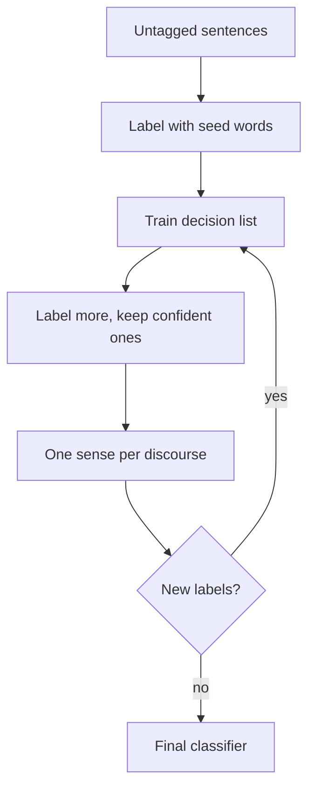

**In simple words:** hand-tagging sentences with word senses is slow and costly, but plain text is cheap. **Yarowsky's bootstrapping** (1995) starts from a **few seed words** per sense and lets the program label more and more sentences by itself. It is **semi-supervised**: a little labelled data plus a lot of unlabelled data. <Cite id="word-sense-disambiguation-yarowsky1995" /> <Cite id="word-sense-disambiguation-wiki-yarowsky" />

**Two ideas it relies on:**

1. **One sense per collocation:** a neighbouring word usually points to one sense (*plant* next to *manufacturing* means factory).
2. **One sense per discourse:** in one document a word keeps one sense.

**Steps** (example word *plant*, senses: living or factory):

1. Collect all sentences containing *plant* from untagged text.
2. Give one seed per sense: *life* for living, *manufacturing* for factory. Sentences with a seed get that label.
3. Train a **decision list** on the labelled sentences; it learns new clues (*species*, *animal*, *worker*, *assembly*).
4. Use it to label the rest; keep only the confident labels.
5. Apply one sense per discourse to make each document consistent.
6. Repeat steps 3 to 5 until no new sentence can be labelled. <Cite id="word-sense-disambiguation-tp-wsd" />

**Result and limits:** about 96% accuracy on two-sense words, close to supervised methods. A wrong early label can spread, and the two rules do not hold for every word. <Cite id="ambiguity-challenges-navigli2009" loc="§3.8.1" />
