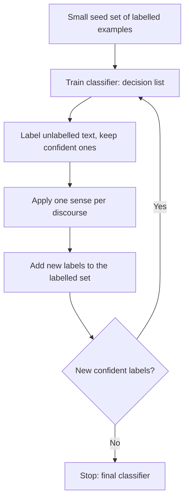

**In simple words:** start with a few labelled examples, let the computer label more by itself, and repeat. <Cite id="class-nlp-pyq4" loc="p. 7" />

**Definition:** the Yarowsky algorithm is a semi-supervised learning approach used mainly for WSD. It is an iterative, bootstrapping method that uses a small set of labelled data (seed examples) to classify a large amount of unlabelled data. <Cite id="class-nlp-pyq4" loc="p. 7" />

**Two principles it relies on** <Cite id="class-nlp-pyq4" loc="p. 7" />

1. **One sense per collocation:** a word that appears with a specific nearby word tends to have the same meaning every time. *Example:* "financial" together with "bank" strongly suggests the financial institution sense.
2. **One sense per discourse:** a word tends to have only one meaning within a single document or text.

**Process:** <Cite id="class-nlp-pyq4" loc="p. 7" /> <Cite id="class-nlp-pyq4" loc="p. 8" /> (1) hand-label a few seed examples per sense; (2) train a decision-list classifier on them; (3) label the unlabelled text, keeping only confident predictions; (4) apply one sense per discourse; (5) add the new labels and retrain; (6) stop when no new confident labels appear.

**Advantage:** only a small labelled seed set is needed. **Disadvantage:** poor seeds spread errors. <Cite id="class-nlp-pyq4" loc="p. 8" />

**Conclusion:** Yarowsky bootstrapping labels a large corpus from a small seed set.
