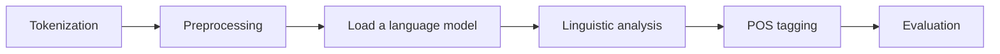
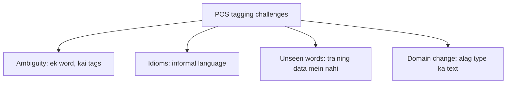

**In simple words:** POS tagging har word ko uski grammatical class ka label deti hai. Ye aasaan lagta hai, par ek hi word alag roles nibha sakta hai, aur tagger ko aise words milte hain jo usne kabhi nahi dekhe. <Cite id="class-nlp-pyq3" loc="p. 4" />

**Definition:** Part-of-speech (POS) tagging NLP ka ek basic task hai jisme sentence ke har word ko ek grammatical category di jaati hai, jaise noun, verb, adjective ya adverb. <Cite id="class-nlp-pyq3" loc="p. 4" />

Ye machines ko sentences ka structure aur meaning samajhne mein madad karta hai, kyunki ye words ke roles aur unke relations pehchanta hai. Isse text analysis, parsing, machine translation aur information extraction behtar hote hain, aur ye text classification, sentiment analysis, chatbots aur search engines mein use hota hai. <Cite id="class-nlp-pyq3" loc="p. 4" />

**Example:** "The quick brown fox jumps over the lazy dog." The/DT quick/JJ brown/JJ fox/NN jumps/VBZ over/IN the/DT lazy/JJ dog/NN. Yahan *quick* aur *brown* adjectives hain jo noun *fox* ko describe karte hain. <Cite id="class-nlp-pyq3" loc="p. 4" />

**Steps:** tokenization (text ko words mein todna), preprocessing (lowercase karna, special characters hatana), language model load karna (NLTK ya SpaCy jaise tools), linguistic analysis (context mein har word ka role), POS tagging, aur evaluation (accuracy check karna aur errors sudharna). <Cite id="class-nlp-pyq3" loc="p. 4" /> <Cite id="class-nlp-pyq3" loc="p. 5" />

**Challenges** <Cite id="class-nlp-pyq3" loc="p. 5" />

1. **Ambiguity:** ek word ke context ke hisaab se kai meanings ya tags ho sakte hain. *Book* "read a book" mein noun hai aur "book a ticket" mein verb.
2. **Idiomatic expressions:** informal language aur idioms ko sahi tag karna mushkil hai.
3. **Out-of-vocabulary words:** pehle na dekhe gaye words (naye words, names) galat tags dete hain.
4. **Domain dependence:** model apni training domain ke bahar achha nahi chalta (news text versus tweets).

**Conclusion:** ambiguity, idioms, unseen words aur domain change main challenges hain; context, bada tagged corpus aur same domain mein training se ye kam hote hain.
