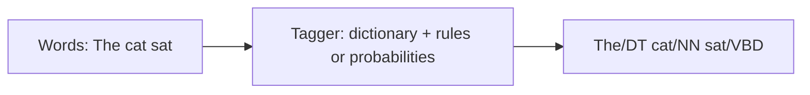

**In simple words:** **part-of-speech (POS) tagging** sentence ke har word ko uski grammatical class (noun, verb, adjective ...) dene ka kaam hai, Penn Treebank jaise tag set se. <Cite id="pos-tagging-wiki-pos-tagging" /> <Cite id="pos-tagging-tp-pos" />

**Example.** *The/DT cat/NN sat/VBD on/IN the/DT mat/NN* (DT determiner, NN noun, VBD past verb, IN preposition).

**Ye kyun zaroori hai.** Tags parsing, word sense disambiguation, information extraction, speech synthesis (*record* noun ya verb ke roop mein alag bola jaata hai) aur machine translation mein madad karte hain.

**POS tagging ki challenges:**

1. **Ambiguity.** Ek word, kai tags. *Book that flight* (verb) aur *read a book* (noun); WSJ corpus mein *back* ke chhe tags hain. Running words ka lagbhag 55 se 67% ambiguous hota hai, jabki zyada tar word types nahi hote. <Cite id="pos-tagging-slp3-ch18" loc="§18.2" />
2. **Unknown words.** Names, naye coinages aur spelling mistakes training data mein nahi hote, isliye probabilities nahi milti. Suffix aur capital-letter clues use hote hain.
3. **Multi-word units aur idioms.** *New York*, *in spite of*, *kick the bucket*: kya inhe ek token aur ek tag milna chahiye?
4. **Alag tag sets.** Tag sets ka size alag hota hai (Penn mein 45 tags, Universal mein lagbhag 17), isliye taggers aur corpora share karna mushkil hai.
5. **Data sparsity.** Bahut se word-tag aur tag-tag pairs corpus mein kabhi nahi aate, probability zero ho jaati hai; smoothing chahiye.
6. **Neighbours se door ka context.** Sahi tag door ke words pe depend kar sakta hai, jo ek ya do pichhle tags dekhne wala tagger miss karta hai.
7. **Domain aur text type.** News pe trained tagger tweets, medical text ya slang wali speech pe kharab chalta hai.
8. **Rich-morphology languages** (Hindi, Marathi, Turkish) mein bahut word forms hote hain aur richer tags chahiye.
9. **Insaanon ka disagreement.** Annotators sirf lagbhag 97% baar agree karte hain, ye ceiling hai. <Cite id="pos-tagging-slp3-ch18" loc="§18.2" /> <Cite id="pos-tagging-gfg-pos" />

**Handling:** context (neighbouring tags), probabilities (HMM, MaxEnt, CRF), rule patterns aur bade tagged corpora use karo. "Most frequent tag" baseline hi lagbhag 92% deta hai; best systems lagbhag 97% tak jaate hain. <Cite id="pos-tagging-nltk-ch5" />

**Conclusion:** POS tagging unambiguous words ke liye easy hai aur wahin mushkil hai jahan words ambiguous, unknown ya unusual hain.
