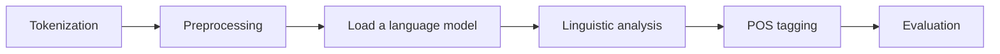
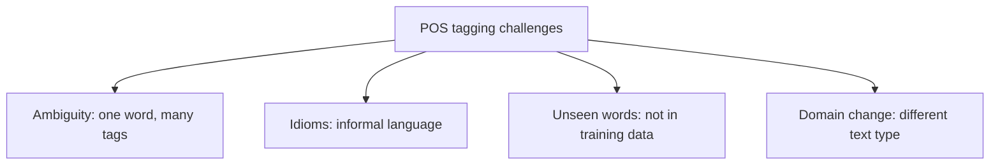

**In simple words:** POS tagging labels every word with its grammatical class. It looks easy, but the same word can play different roles, and the tagger meets words it has never seen. <Cite id="class-nlp-pyq3" loc="p. 4" />

**Definition:** Part-of-speech (POS) tagging is a fundamental task in NLP where each word in a sentence is assigned a grammatical category such as noun, verb, adjective or adverb. <Cite id="class-nlp-pyq3" loc="p. 4" />

It helps machines understand the structure and meaning of sentences by identifying the roles of words and their relationships. It improves text analysis, parsing, machine translation and information extraction, and is used in text classification, sentiment analysis, chatbots and search engines. <Cite id="class-nlp-pyq3" loc="p. 4" />

**Example:** "The quick brown fox jumps over the lazy dog." The/DT quick/JJ brown/JJ fox/NN jumps/VBZ over/IN the/DT lazy/JJ dog/NN. Here *quick* and *brown* are adjectives that describe the noun *fox*. <Cite id="class-nlp-pyq3" loc="p. 4" />

**Steps:** tokenization (split the text into words), preprocessing (lower-case, remove special characters), loading a language model (tools like NLTK or SpaCy), linguistic analysis (role of each word in context), POS tagging, and evaluation (check accuracy and correct the errors). <Cite id="class-nlp-pyq3" loc="p. 4" /> <Cite id="class-nlp-pyq3" loc="p. 5" />

**Challenges** <Cite id="class-nlp-pyq3" loc="p. 5" />

1. **Ambiguity:** a word can have several meanings or tags depending on the context. *Book* is a noun in "read a book" and a verb in "book a ticket".
2. **Idiomatic expressions:** informal language and idioms are hard to tag correctly.
3. **Out-of-vocabulary words:** words not seen before (new words, names) lead to wrong tags.
4. **Domain dependence:** a model may not work well outside the domain it was trained on (news text versus tweets).

**Conclusion:** ambiguity, idioms, unseen words and domain change are the main challenges; context, a large tagged corpus and training on the same domain reduce them.
