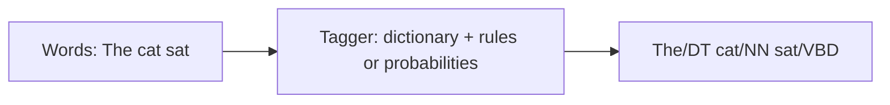

**In simple words:** **part-of-speech (POS) tagging** is the job of giving every word in a sentence its grammatical class (noun, verb, adjective ...), using a tag set such as the Penn Treebank. <Cite id="pos-tagging-wiki-pos-tagging" /> <Cite id="pos-tagging-tp-pos" />

**Example.** *The/DT cat/NN sat/VBD on/IN the/DT mat/NN* (DT determiner, NN noun, VBD past verb, IN preposition).

**Why it is needed.** Tags help parsing, word sense disambiguation, information extraction, speech synthesis (*record* as noun or verb is pronounced differently) and machine translation.

**Challenges of POS tagging:**

1. **Ambiguity.** One word, several tags. *Book that flight* (verb) versus *read a book* (noun); *back* has six tags in the WSJ corpus. About 55 to 67% of running words are ambiguous, even though most word types are not. <Cite id="pos-tagging-slp3-ch18" loc="§18.2" />
2. **Unknown words.** Names, new coinages and spelling mistakes are not in the training data, so no probabilities exist. Suffix and capital-letter clues are used.
3. **Multi-word units and idioms.** *New York*, *in spite of*, *kick the bucket*: should they be one token with one tag?
4. **Different tag sets.** Tag sets differ in size (Penn 45 tags, Universal about 17), so taggers and corpora are hard to share.
5. **Data sparsity.** Many word-tag and tag-tag pairs never occur in a corpus, giving zero probability; smoothing is needed.
6. **Context beyond neighbours.** The right tag may depend on words far away, which a tagger looking at one or two previous tags misses.
7. **Domain and text type.** A tagger trained on news does badly on tweets, medical text or speech with slang and missing punctuation.
8. **Rich-morphology languages** (Hindi, Marathi, Turkish) have many word forms and need richer tags.
9. **Human disagreement.** Annotators agree only about 97% of the time, so that is the ceiling. <Cite id="pos-tagging-slp3-ch18" loc="§18.2" /> <Cite id="pos-tagging-gfg-pos" />

**Handling:** use context (neighbouring tags), probabilities (HMM, MaxEnt, CRF), rule patterns and large tagged corpora. A baseline of "most frequent tag" already gives about 92%; the best systems reach about 97%. <Cite id="pos-tagging-nltk-ch5" />

**Conclusion:** POS tagging is easy for unambiguous words and hard exactly where words are ambiguous, unknown or unusual.
