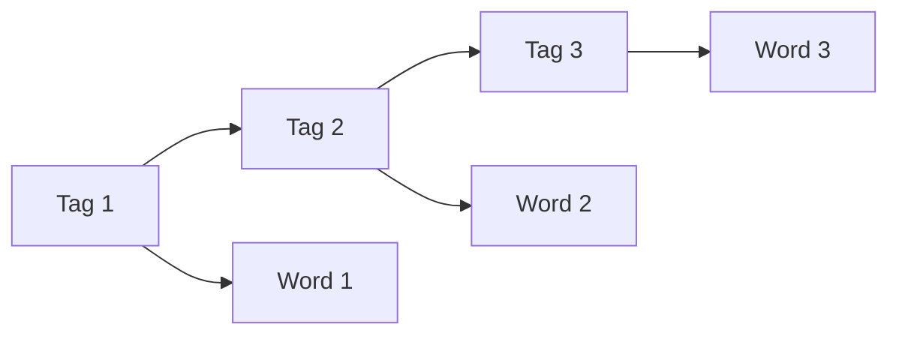

**In simple words:** Hidden Markov Model (HMM) tagger visible words ke peeche chhupe tags do tables se guess karta hai: tag-to-tag aur tag-to-word probabilities. Ye simple hai, lekin iski clear limits hain. <Cite id="hmm-maxent-crf-gfg-hmm-ml" />

**Limitations:**

1. **Strong independence assumptions.** Tag sirf pichhle tag pe depend karta hai (Markov), aur word sirf apne tag pe. Lambe patterns aur next word ignore hote hain. <Cite id="hmm-maxent-crf-slp3-appA" loc="§A.2" />
2. **Features jodna mushkil.** Capital letter, suffix *-ed* ya digits jaise clues aasani se nahi jode ja sakte; sab kuch do tables mein fit karna padta hai. <Cite id="hmm-maxent-crf-slp3-ch18" loc="§18.5" />
3. **Unknown words.** Training mein na dikha word har tag ke liye probability 0 rakhta hai, isliye path mar jaata hai jab tak special guess (suffix) na jode. <Cite id="hmm-maxent-crf-collins-hmm" loc="§2.7.1" />
4. **Data sparsity.** Unseen tag pairs aur word-tag pairs ka count zero hota hai aur smoothing chahiye.
5. **Generative model.** Ye words aur tags ki joint probability model karta hai (words kaise bante hain) jabki hume sirf words diye hue tags chahiye. MaxEnt aur CRF jaise discriminative models exactly isi ke liye train hote hain.
6. **Tagged corpus chahiye.** Achhi accuracy ke liye bada hand-tagged corpus chahiye; unsupervised training (Baum-Welch) slow aur kamzor hai.
7. **Local view.** Bigram HMM sirf ek tag ki history use karta hai; long-distance links miss hote hain.

**Conclusion:** HMM ek achha simple baseline hai, lekin richer models (MaxEnt, CRF) in zyada tar limits ko hata dete hain.
