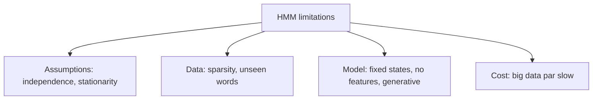

**In simple words:** HMM tagger simple aur banane mein tez hai, par uski simple assumptions use limit karti hain. <Cite id="class-nlp-pyq3" loc="p. 5" />

1. **Strong independence assumption:** agla state sirf current state par depend karta hai, aur har observation sirf apni hidden state par.
2. **Limited context modelling:** ye door-door ke words ke beech ki dependencies nahi pakad sakta.
3. **Fixed number of states:** hidden states pehle se define karni padti hain, jo complex NLP tasks ke liye fit nahi ho sakti.
4. **Data sparsity problem:** transition aur emission probabilities sahi estimate karne ke liye bada labelled dataset chahiye.
5. **Stationarity assumption:** ye maanta hai ki probabilities constant rehti hain, jo natural language ke liye sach nahi.
6. **Handling of unseen words:** training data mein na aaye words (OOV problem) achhe se handle nahi hote.
7. **Limited expressive power:** HMM generative models hain aur discriminative models (CRFs, RNNs) jaise complex conditional relations model nahi kar sakte.
8. **Computational complexity:** vocabulary ya states zyaada hon to training aur decoding mein bahut time lagta hai.
9. **Inflexibility for feature inclusion:** grammar ya meaning jaisi extra information add karna mushkil hai.
10. **Inferior to modern models:** RNNs aur Transformers context ko bahut behtar samajhte hain aur zyaada accurate hain.

**Conclusion:** in limits ki wajah se aksar discriminative models (MaxEnt, CRF) aur neural models pasand kiye jaate hain.
