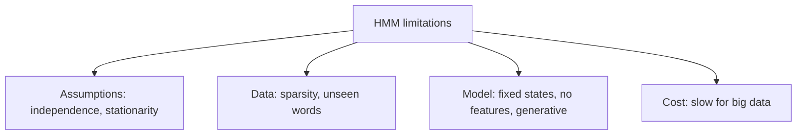

**In simple words:** an HMM tagger is simple and fast to build, but its simple assumptions limit it. <Cite id="class-nlp-pyq3" loc="p. 5" />

1. **Strong independence assumption:** the next state depends only on the current state, and each observation depends only on its own hidden state.
2. **Limited context modelling:** it cannot capture long-range dependencies between distant words.
3. **Fixed number of states:** the hidden states must be defined in advance, which may not fit complex NLP tasks.
4. **Data sparsity problem:** it needs large labelled datasets to estimate transition and emission probabilities well.
5. **Stationarity assumption:** it assumes the probabilities stay constant, which is not true for natural language.
6. **Handling of unseen words:** words not in the training data (the OOV problem) are not handled well.
7. **Limited expressive power:** HMMs are generative models and cannot model complex conditional relationships like discriminative models (CRFs, RNNs).
8. **Computational complexity:** training and decoding take a long time when the vocabulary or the number of states is large.
9. **Inflexibility for feature inclusion:** it is hard to add extra information like grammar or meaning.
10. **Inferior to modern models:** RNNs and Transformers understand context much better and are more accurate.

**Conclusion:** because of these limits, discriminative models (MaxEnt, CRF) and neural models are often preferred.
