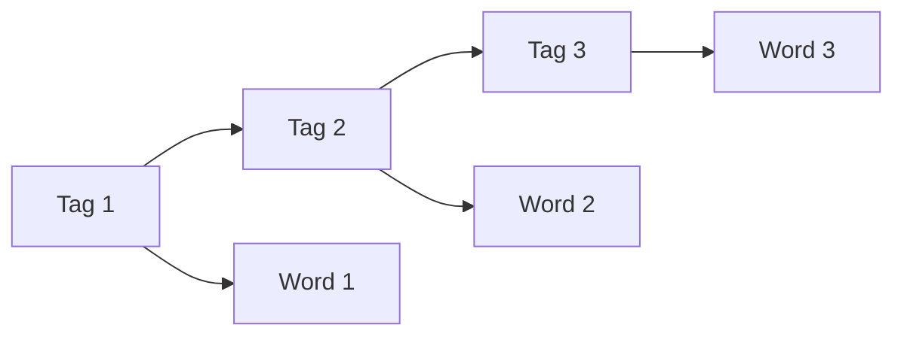

**In simple words:** a Hidden Markov Model (HMM) tagger guesses the hidden tags behind the visible words using two tables: tag-to-tag and tag-to-word probabilities. It is simple, but it has clear limits. <Cite id="hmm-maxent-crf-gfg-hmm-ml" />

**Limitations:**

1. **Strong independence assumptions.** A tag depends only on the previous tag (Markov), and a word depends only on its own tag. Longer patterns and the next word are ignored. <Cite id="hmm-maxent-crf-slp3-appA" loc="§A.2" />
2. **Hard to add features.** Clues such as a capital letter, the suffix *-ed* or digits cannot be added easily; everything must fit the two tables. <Cite id="hmm-maxent-crf-slp3-ch18" loc="§18.5" />
3. **Unknown words.** A word not seen in training has probability 0 for every tag, so the path dies unless a special guess (suffix) is added. <Cite id="hmm-maxent-crf-collins-hmm" loc="§2.7.1" />
4. **Data sparsity.** Unseen tag pairs and word-tag pairs get zero counts and need smoothing.
5. **Generative model.** It models the joint probability of words and tags (how words are produced) although we only need the tags given the words. Discriminative models like MaxEnt and CRF are trained for exactly that.
6. **Needs a tagged corpus.** Good accuracy needs a large hand-tagged corpus; unsupervised training (Baum-Welch) is slower and weaker.
7. **Local view.** Only one tag of history is used for a bigram HMM; long-distance links are missed.

**Conclusion:** the HMM is a good simple baseline, but richer models (MaxEnt, CRF) remove most of these limits.
