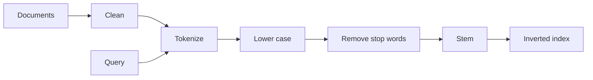

**In simple words:** **Information Retrieval (IR)** system, jaise search engine, query se match hone wale documents dhundta hai. Matching se pehle documents aur query dono ko **same steps** mein clean kiya jaata hai taaki ek word ke alag forms match ho jaayein. <Cite id="nlp-applications-gfg-ir" /> <Cite id="text-preprocessing-gfg-pre" />

**Steps:**

1. **Collect aur clean.** HTML tags, symbols hatao aur encoding fix karo.
2. **Tokenization.** Text ko words (tokens) mein todo. <Cite id="text-preprocessing-slp3-ch2" />
3. **Normalization (case folding).** Lower case mein badlo taaki *Cat* aur *cat* barabar ho.
4. **Stop word removal.** *the, is, of* jaise bahut common words hata do jo search mein madad nahi karte aur index chhota karte hain. Dhyan rahe: "to be or not to be" jaise phrases ko nuksan hota hai. <Cite id="text-preprocessing-wiki-stop" />
5. **Stemming ya lemmatization.** Words ko base form mein lao, taaki *running, runs, ran* match *run* se ho.
6. **Indexing.** **Inverted index** banao: har term ke liye un documents ki list jo use rakhte hain (aksar tf-idf jaisa weight ke saath). <Cite id="nlp-applications-wiki-tfidf" />
7. **Query processing.** Query pe bhi steps 2 se 5 lagao, index mein dhundo aur documents rank karo.

**Example.** *The students are running fast* ban jaata hai `student run fast`.

**Conclusion:** documents aur query pe same cleaning se matching fair hoti hai aur index chhota rehta hai.
