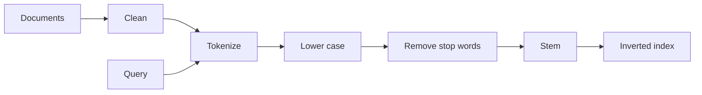

**In simple words:** an **Information Retrieval (IR)** system, such as a search engine, finds the documents that match a query. Before matching, both the documents and the query are cleaned in the **same steps** so that different forms of a word match. <Cite id="nlp-applications-gfg-ir" /> <Cite id="text-preprocessing-gfg-pre" />

**Steps:**

1. **Collect and clean.** Remove HTML tags, symbols and fix encoding.
2. **Tokenization.** Split the text into words (tokens). <Cite id="text-preprocessing-slp3-ch2" />
3. **Normalization (case folding).** Convert to lower case so *Cat* equals *cat*.
4. **Stop word removal.** Drop very common words like *the, is, of* that do not help search and shrink the index. Careful: phrases such as "to be or not to be" suffer. <Cite id="text-preprocessing-wiki-stop" />
5. **Stemming or lemmatization.** Reduce words to a base form, so *running, runs, ran* match *run*.
6. **Indexing.** Build an **inverted index**: for each term, the list of documents that contain it (often with a weight such as tf-idf). <Cite id="nlp-applications-wiki-tfidf" />
7. **Query processing.** Apply the same steps 2 to 5 to the query, look it up in the index and rank documents.

**Example.** *The students are running fast* becomes `student run fast`.

**Conclusion:** the same cleaning on documents and query makes the matching fair and the index small.
