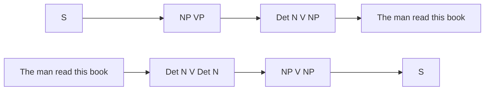

**In simple words:** parsing grammar se sentence ka structure (parse tree) dhundhti hai. Top-down parser start symbol S se shuru karke words tak neeche aata hai. Bottom-up parser words se shuru karke S tak upar jaata hai. <Cite id="class-nlp-pyq3" loc="p. 6" />

| Point | Top-down parsing | Bottom-up parsing |
|---|---|---|
| Idea | Pehle parse tree ka sabse upar ka level dekhta hai aur grammar ke rules se neeche aata hai | Pehle parse tree ka sabse neeche ka level dekhta hai aur grammar ke rules se upar jaata hai |
| Aim | Input string ka leftmost derivation dhundhta hai | Input string ko grammar ke start symbol tak reduce karta hai |
| Direction | Start symbol (top) se leaf nodes (down) tak | Leaf nodes (bottom) se start symbol tak |
| Derivation | Leftmost derivation | Rightmost derivation (ulta) |
| Main decision | String banane ke liye kaunsa production rule use karna hai | String ko start symbol tak reduce karne ke liye production rule kab use karna hai |
| Example | Recursive descent parser | Shift-reduce parser |

<Cite id="class-nlp-pyq3" loc="p. 6" />

**Example:** class grammar S → NP VP, NP → Det N | N, VP → V NP, Det → The | this, N → man | book, V → read, aur sentence "The man read this book":

- **Top-down:** S ⇒ NP VP ⇒ Det N VP ⇒ The N VP ⇒ The man VP ⇒ The man V NP ⇒ The man read NP ⇒ The man read Det N ⇒ The man read this N ⇒ The man read this book.
- **Bottom-up:** The man read this book ⇒ Det N V Det N ⇒ NP V Det N ⇒ NP V NP ⇒ NP VP ⇒ S.

**Conclusion:** top-down goal driven hai (S se shuru, leftmost derivation); bottom-up data driven hai (words se shuru, S tak reduce).
