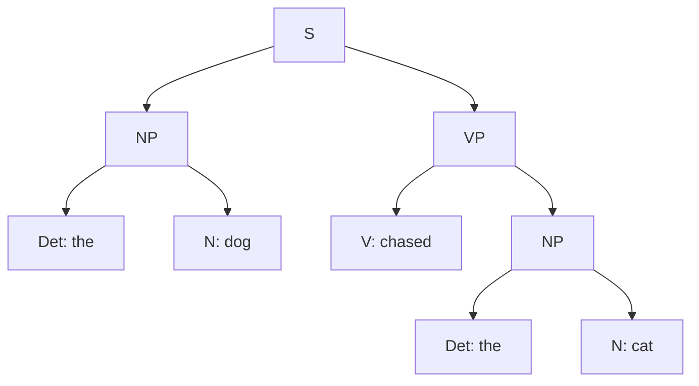

**In simple words:** parser grammar ki madad se sentence ka parse tree dhundta hai. Wo upar (start symbol S) se neeche words tak search kar sakta hai, ya words se upar S tak. <Cite id="cfg-parsing-wiki-td" /> <Cite id="cfg-parsing-wiki-bu" />

- **Top-down parsing** goal-driven hai: S se shuru karo, rules se expand karo, aur leaves ko words se match karo.
- **Bottom-up parsing** data-driven hai: words se shuru karo, unki word classes dhundo, aur rules ko ulta lagakar combine karo jab tak S na mil jaye.

**Example ka grammar:** S → NP VP; NP → Det N; VP → V NP; Det → the; N → dog | cat; V → chased. **Sentence:** *the dog chased the cat*.

| Step | Top-down (expand, left to right) | Bottom-up (reduce) |
|---|---|---|
| 1 | S | the dog chased the cat |
| 2 | NP VP | Det dog chased Det cat |
| 3 | Det N VP | Det N chased Det N |
| 4 | the N VP, then the dog VP | NP chased NP (Det N reduced to NP twice) |
| 5 | the dog V NP | NP V NP |
| 6 | the dog chased NP | NP VP (V NP reduced to VP) |
| 7 | the dog chased Det N, then the cat | S (NP VP reduced to S) |

Yahan dono same 9 rule applications use karte hain: S → NP VP, NP → Det N do baar, Det → the do baar, N → dog aur cat, VP → V NP, V → chased. <Cite id="cfg-parsing-slp3-19" />

| Point | Top-down | Bottom-up |
|---|---|---|
| Starts from | S | Words |
| Direction | S to words | Words to S |
| Driven by | Goal | Data |
| Strength | Sirf wahi trees banata hai jo S se shuru hon | Asli words use karta hai, bekaar predictions nahi |
| Weakness | Galat guesses, backtracking, left recursion pe loop (NP → NP PP) | Aise phrases banata hai jo kabhi S tak nahi pahunchte |
| Example parsers | Recursive descent | Shift-reduce, CYK |

<Cite id="cfg-parsing-gfg-types" /> <Cite id="cfg-parsing-tp-syn" />

**Conclusion:** top-down kabhi bekaar tree nahi banata lekin aise words guess kar sakta hai jo hain hi nahi; bottom-up words ka respect karta hai lekin bekaar phrases bana sakta hai. Chart parsers (CYK, Earley) dono mix karte hain aur results store karte hain taaki kaam repeat na ho.
