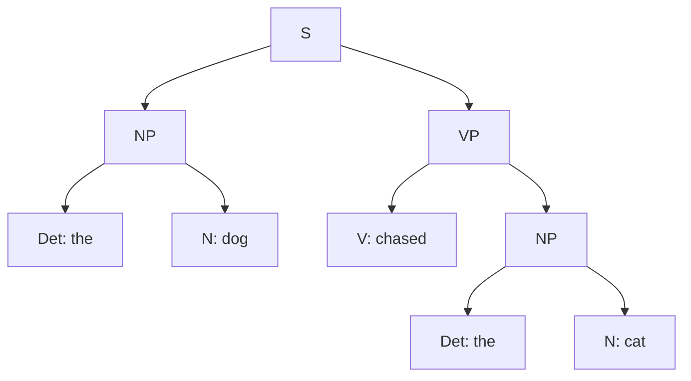

**In simple words:** a parser finds the parse tree of a sentence using a grammar. It can search from the top (start symbol S) down to the words, or from the words up to S. <Cite id="cfg-parsing-wiki-td" /> <Cite id="cfg-parsing-wiki-bu" />

- **Top-down parsing** is goal-driven: start with S, expand it with rules, and check the leaves against the words.
- **Bottom-up parsing** is data-driven: start with the words, find their word classes, and combine them with the rules backwards until S is reached.

**Grammar for the example:** S → NP VP; NP → Det N; VP → V NP; Det → the; N → dog | cat; V → chased. **Sentence:** *the dog chased the cat*.

| Step | Top-down (expand, left to right) | Bottom-up (reduce) |
|---|---|---|
| 1 | S | the dog chased the cat |
| 2 | NP VP | Det dog chased Det cat |
| 3 | Det N VP | Det N chased Det N |
| 4 | the N VP, then the dog VP | NP chased NP (Det N reduced to NP twice) |
| 5 | the dog V NP | NP V NP |
| 6 | the dog chased NP | NP VP (V NP reduced to VP) |
| 7 | the dog chased Det N, then the cat | S (NP VP reduced to S) |

Both use the same 9 rule applications here: S → NP VP, NP → Det N twice, Det → the twice, N → dog and cat, VP → V NP, V → chased. <Cite id="cfg-parsing-slp3-19" />

| Point | Top-down | Bottom-up |
|---|---|---|
| Starts from | S | Words |
| Direction | S to words | Words to S |
| Driven by | Goal | Data |
| Strength | Builds only trees that start from S | Uses the actual words, no useless predictions |
| Weakness | Wrong guesses, backtracking, loops on left recursion (NP → NP PP) | Builds phrases that can never reach S |
| Example parsers | Recursive descent | Shift-reduce, CYK |

<Cite id="cfg-parsing-gfg-types" /> <Cite id="cfg-parsing-tp-syn" />

**Conclusion:** top-down never builds a useless tree but may guess words that are not there; bottom-up respects the words but may build useless phrases. Chart parsers (CYK, Earley) mix both and store results to avoid repeating work.
