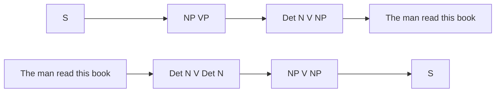

**In simple words:** parsing finds the structure (parse tree) of a sentence from a grammar. A top-down parser starts from the start symbol S and works down to the words. A bottom-up parser starts from the words and works up to S. <Cite id="class-nlp-pyq3" loc="p. 6" />

| Point | Top-down parsing | Bottom-up parsing |
|---|---|---|
| Idea | First looks at the highest level of the parse tree and works down using the rules of the grammar | First looks at the lowest level of the parse tree and works up using the rules of the grammar |
| Aim | Tries to find the leftmost derivation of the input string | Tries to reduce the input string to the start symbol of the grammar |
| Direction | From the start symbol (top) to the leaf nodes (down) | From the leaf nodes (bottom) up to the start symbol |
| Derivation | Leftmost derivation | Rightmost derivation (in reverse) |
| Main decision | Which production rule to use to construct the string | When to use a production rule to reduce the string to the start symbol |
| Example | Recursive descent parser | Shift-reduce parser |

<Cite id="class-nlp-pyq3" loc="p. 6" />

**Example** with the class grammar S → NP VP, NP → Det N | N, VP → V NP, Det → The | this, N → man | book, V → read, and the sentence "The man read this book":

- **Top-down:** S ⇒ NP VP ⇒ Det N VP ⇒ The N VP ⇒ The man VP ⇒ The man V NP ⇒ The man read NP ⇒ The man read Det N ⇒ The man read this N ⇒ The man read this book.
- **Bottom-up:** The man read this book ⇒ Det N V Det N ⇒ NP V Det N ⇒ NP V NP ⇒ NP VP ⇒ S.

**Conclusion:** top-down is goal driven (starts from S, leftmost derivation); bottom-up is data driven (starts from the words, reduces to S).
