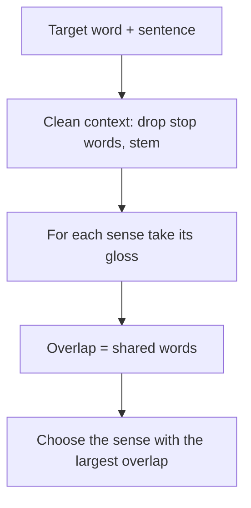

**In simple words:** bahut se words ke ek se zyada meaning hote hain. **Word sense disambiguation (WSD)** ye dhundne ka kaam hai ki diye gaye sentence mein word ka kaunsa meaning hai. *He sat on the river bank* mein *bank* paani ke paas ki zameen hai, paise ka office nahi. <Cite id="word-sense-disambiguation-gfg-wsd" /> <Cite id="ambiguity-challenges-navigli2009" />

**Ye kyun zaroori hai.** Machine translation (*bank* ke Hindi mein alag words hain), information retrieval (*bank* search karne par sahi kism ke pages aane chahiye), question answering aur text-to-speech sab galat ho jaate hain agar sense galat ho.

**Approaches:** knowledge-based (dictionary), supervised (tagged text se seekho), semi-supervised (bootstrapping) aur unsupervised (clustering).

**Dictionary-based approach (Lesk, 1986).** Jo words ek sentence mein saath aate hain wo same topic ke hote hain, isliye sahi sense ki **definition (gloss)** aas-paas ke words se kuch words share karti hai. Dictionary ya WordNet glosses deta hai; tagged corpus ki zaroorat nahi. <Cite id="word-sense-disambiguation-wiki-lesk" /> <Cite id="word-sense-disambiguation-slp3-I" />

**Steps (simplified Lesk):**

1. Target word aur uska sentence lo; baaki words **context** hain.
2. Stop words (the, in, of) hatao aur words ko stems mein badlo.
3. Har sense ke liye uska gloss (aur example) uska **signature** lo.
4. Signature aur context ke beech **overlap** (shared words) gino.
5. Sabse bade overlap wala sense chuno; agar sab 0 hon to most frequent sense lo. <Cite id="word-sense-disambiguation-cam-l98" />

<Sum>

<Given>

Sentence: *He deposited money in the bank.* *bank* ke senses (simplified glosses): S1 "a financial institution that accepts deposits and lends money"; S2 "sloping land beside a river or stream".

</Given>

<Find>

*bank* ka sense.

</Find>

<Steps>

1. Stop word *he* hatane aur stemming ke baad context: \{deposit, money\}. *Reason: stems se deposited ka match deposits se ho jaata hai.*
2. S1 ka signature stop words ke bina: \{financial, institution, accept, deposit, lend, money\}. Shared: deposit, money, to overlap $= 2$.
3. S2 ka signature: \{slope, land, beside, river, stream\}. Shared: koi nahi, to overlap $= 0$.
4. Sabse bada overlap: S1 ($2 > 0$).

</Steps>

<Answer>

*bank* ka matlab financial institution (S1) hai.

</Answer>

<Box kind="verify">

Meaning check: paise financial institution mein jama hote hain, nadi ki dhalaan mein nahi. Har gloss mein sirf do context words dhundkar overlaps dobara ginne par bhi 2 aur 0 aate hain.

</Box>

</Sum>

**Advantages:** tagged data nahi chahiye; dictionary ke kisi bhi word ke liye chalta hai. **Disadvantages:** glosses chhote hote hain, isliye overlap aksar 0 ya tie hota hai; result dictionary ki quality pe depend karta hai; original version slow hai kyunki wo saare words ke saare senses compare karta hai. **Extended Lesk** related senses (hypernyms) ke glosses bhi jodta hai taaki ye theek ho. <Cite id="ambiguity-challenges-navigli2009" loc="§5.1" />
