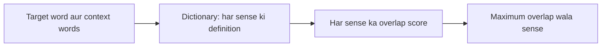

**In simple words:** dictionary-based (knowledge-based) approach word ki meaning aise tay karta hai: uske aas-paas ke words ko dictionary mein likhi meanings se compare karta hai. <Cite id="class-nlp-pyq4" loc="p. 5" />

**WSD kya hai?** Word Sense Disambiguation us word ki sahi meaning tay karne par focus karta hai jiske kai possible interpretations hain. Bahut se words ambiguous hote hain, isliye context ke saath meaning badalti hai. WSD NLP system ko aas-paas ke words analyze karke intended sense dhundhne deta hai. <Cite id="class-nlp-pyq4" loc="p. 5" />

*Example:* "She deposited money in the bank" (financial institution) aur "The fisherman sat on the river bank" (nadi ke kinare ki zameen). <Cite id="class-nlp-pyq4" loc="p. 5" />

**Dictionary-based (knowledge-based) approach:** ye dictionaries aur semantic networks jaise lexical resources se word meanings tay karta hai. Lesk algorithm isi approach par kaam karta hai. <Cite id="class-nlp-pyq4" loc="p. 5" />

1. Context words ko candidate senses ki dictionary definitions se compare karo.
2. Context words aur definition words ke beech overlap calculate karo.
3. Maximum overlap score wala sense chuno.

Ye maanta hai ki coherent text mein saath use hue words ke semantic relationships unki dictionary definitions mein dikhte hain. <Cite id="class-nlp-pyq4" loc="p. 5" />

<Sum>

<Given>

sentence "I deposited money in the bank", aur *bank* ke do dictionary senses: sense 1 "an institution that keeps money and gives loans"; sense 2 "the land at the side of a river". (Ye chhoti definitions example ke liye banayi gayi hain.)

</Given>

<Find>

Lesk's algorithm ne *bank* ka kaunsa sense chuna.

</Find>

<Steps>

1. Target word: *bank*. Context window: *deposited*, *money*.
2. Definitions se common words hatao (an, the, of, at, that, and, in).
3. Sense 1 mein bachte hain: institution, keeps, money, gives, loans. Context ke saath overlap = word *money*, yaani 1.
4. Sense 2 mein bachte hain: land, side, river. Context ke saath overlap = 0.
5. Sabse zyaada overlap 1 hai, sense 1 ka.

</Steps>

<Answer>

*bank* = financial institution (sense 1).

</Answer>

<Box kind="verify">

Doosra sentence try karo "The fisherman sat on the river bank". Context: *fisherman*, *sat*, *river*. Sense 1 overlap = 0; sense 2 overlap = word *river*, yaani 1, isliye wo nadi ke kinare wala sense chunta hai, jo sahi hai. Alag context par method alag answer deta hai.

</Box>

</Sum>

**Advantages:** annotated training data nahi chahiye, maujood linguistic knowledge bases use hote hain, aur uske decisions samajhna aasaan hai. <Cite id="class-nlp-pyq4" loc="p. 5" />
**Disadvantages:** senses similar hon to accuracy girti hai, overlap kam ho to fail hota hai, aur dictionary par depend karta hai. <Cite id="class-nlp-pyq4" loc="p. 3" /> <Cite id="class-nlp-pyq4" loc="p. 4" />

**Conclusion:** dictionary-based approach (Lesk) wo sense chunta hai jiski definition context ke saath sabse zyaada overlap kare.
