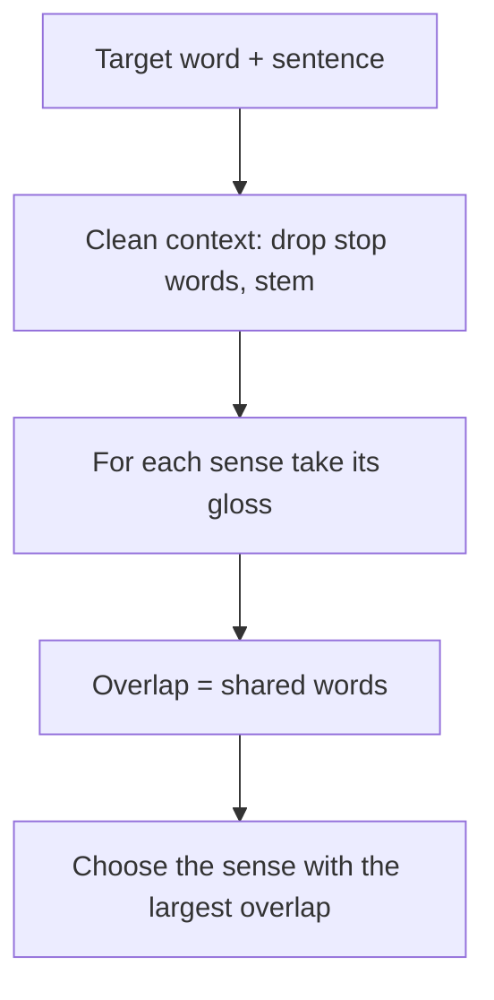

**In simple words:** many words have more than one meaning. **Word sense disambiguation (WSD)** is the task of finding which meaning a word has in a given sentence. In *He sat on the river bank*, *bank* is land beside water, not a money office. <Cite id="word-sense-disambiguation-gfg-wsd" /> <Cite id="ambiguity-challenges-navigli2009" />

**Why it is needed.** Machine translation (*bank* has different words in Hindi), information retrieval (a search for *bank* should return the right kind of page), question answering and text-to-speech all go wrong if the sense is wrong.

**Approaches:** knowledge-based (dictionary), supervised (learn from tagged text), semi-supervised (bootstrapping) and unsupervised (clustering).

**Dictionary-based approach (Lesk, 1986).** Words that occur together in a sentence are about the same topic, so the **definition (gloss)** of the correct sense shares words with the words around it. The dictionary or WordNet supplies the glosses; no tagged corpus is needed. <Cite id="word-sense-disambiguation-wiki-lesk" /> <Cite id="word-sense-disambiguation-slp3-I" />

**Steps (simplified Lesk):**

1. Take the target word and its sentence; the other words are the **context**.
2. Remove stop words (the, in, of) and reduce words to stems.
3. For each sense, take its gloss (and example) as its **signature**.
4. Count the **overlap** (shared words) between signature and context.
5. Choose the sense with the largest overlap; if all are 0, take the most frequent sense. <Cite id="word-sense-disambiguation-cam-l98" />

<Sum>

<Given>

Sentence: *He deposited money in the bank.* Senses of *bank* (simplified glosses): S1 "a financial institution that accepts deposits and lends money"; S2 "sloping land beside a river or stream".

</Given>

<Find>

the sense of *bank*.

</Find>

<Steps>

1. Context after removing the stop word *he* and stemming: \{deposit, money\}. *Reason: stems let deposited match deposits.*
2. Signature of S1 without stop words: \{financial, institution, accept, deposit, lend, money\}. Shared: deposit, money, so overlap $= 2$.
3. Signature of S2: \{slope, land, beside, river, stream\}. Shared: none, so overlap $= 0$.
4. Largest overlap: S1 ($2 > 0$).

</Steps>

<Answer>

*bank* means the financial institution (S1).

</Answer>

<Box kind="verify">

Meaning check: money is deposited in a financial institution, not in a river slope. Recounting the overlaps by looking only for the two context words in each gloss again gives 2 and 0.

</Box>

</Sum>

**Advantages:** needs no tagged data; works for any word in the dictionary. **Disadvantages:** glosses are short, so overlaps are often 0 or tied; results depend on dictionary quality; the original version is slow because it compares all senses of all words. **Extended Lesk** also adds the glosses of related senses (hypernyms) to fix this. <Cite id="ambiguity-challenges-navigli2009" loc="§5.1" />
