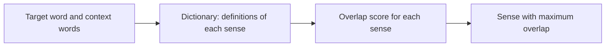

**In simple words:** a dictionary-based (knowledge-based) approach decides the meaning of a word by comparing its surroundings with the meanings written in a dictionary. <Cite id="class-nlp-pyq4" loc="p. 5" />

**What is WSD?** Word Sense Disambiguation focuses on determining the correct meaning of a word when it has multiple possible interpretations. Many words are ambiguous, so their meaning changes with the context. WSD lets an NLP system analyze the surrounding words and find the intended sense. <Cite id="class-nlp-pyq4" loc="p. 5" />

*Example:* "She deposited money in the bank" (financial institution) and "The fisherman sat on the river bank" (land beside a river). <Cite id="class-nlp-pyq4" loc="p. 5" />

**Dictionary-based (knowledge-based) approach:** it uses lexical resources such as dictionaries and semantic networks to decide word meanings. The Lesk algorithm works on this approach. <Cite id="class-nlp-pyq4" loc="p. 5" />

1. Compare the context words with the dictionary definitions of the candidate senses.
2. Calculate the overlap between the context words and the definition words.
3. Select the sense with the maximum overlap score.

It assumes that words used together in coherent text have semantic relationships that show in their dictionary definitions. <Cite id="class-nlp-pyq4" loc="p. 5" />

<Sum>

<Given>

the sentence "I deposited money in the bank", and two dictionary senses of *bank*: sense 1 "an institution that keeps money and gives loans"; sense 2 "the land at the side of a river". (These short definitions are made up for the example.)

</Given>

<Find>

the sense of *bank* chosen by Lesk's algorithm.

</Find>

<Steps>

1. Target word: *bank*. Context window: *deposited*, *money*.
2. Remove common words from the definitions (an, the, of, at, that, and, in).
3. Sense 1 keeps: institution, keeps, money, gives, loans. Overlap with the context = the word *money*, so 1.
4. Sense 2 keeps: land, side, river. Overlap with the context = 0.
5. The highest overlap is 1, for sense 1.

</Steps>

<Answer>

*bank* = financial institution (sense 1).

</Answer>

<Box kind="verify">

Try the other sentence "The fisherman sat on the river bank". Context: *fisherman*, *sat*, *river*. Sense 1 overlap = 0; sense 2 overlap = the word *river*, so 1, so it picks the land beside the river, which is right. The method gives different answers for different contexts.

</Box>

</Sum>

**Advantages:** it does not need annotated training data, it uses existing linguistic knowledge bases, and its decisions are easy to interpret. <Cite id="class-nlp-pyq4" loc="p. 5" />
**Disadvantages:** accuracy drops when senses are similar, it fails when there is little overlap, and it depends on the dictionary. <Cite id="class-nlp-pyq4" loc="p. 3" /> <Cite id="class-nlp-pyq4" loc="p. 4" />

**Conclusion:** the dictionary-based approach (Lesk) selects the sense whose definition overlaps most with the context.
