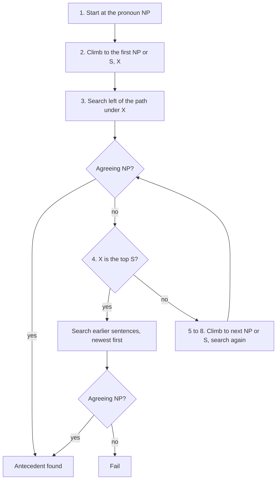

**In simple words:** *he* ya *him* jaisa pronoun pehle aaye noun phrase ki taraf ishara karta hai, jise uska **antecedent** kehte hain. **Hobbs' algorithm** (1978) ise **parse trees** pe ek fixed order mein chalkar dhundta hai: pehle same sentence ki sabse nazdeeki jagah, phir pichhle sentences, naye se purane. Pronoun se agree karne wala pehla noun phrase (NP) answer hai. <Cite id="anaphora-resolution-hobbs1978" /> <Cite id="anaphora-resolution-ibm-coref" />

**Ye kyun zaroori hai.** Text samajhne, summarise ya translate karne ke liye machine ko pata hona chahiye ki *he* kaun hai. Hobbs ek simple rule-based method deta hai jise training data nahi chahiye aur jo ek strong baseline tha. <Cite id="anaphora-resolution-tetreault2001" />

**Terms.** *Breadth-first* matlab ek level ke saare nodes dekho phir aur gehre jao. *Agreement* matlab same number, gender aur person.

**Algorithm:**

1. Us NP node se shuru karo jo pronoun ko dominate karta hai.
2. Upar jaakar pehle NP ya S node tak jao; use X aur path ko p kaho.
3. X ke neeche, p ke **left** mein, left-to-right, breadth-first search karo. Koi bhi NP propose karo jiske aur X ke beech koi aur NP ya S ho.
4. Agar X top S hai, to **pichhle sentences** mein search karo, sabse recent pehle, left-to-right, breadth-first, har NP propose karte hue. Warna step 5.
5. Agle NP ya S node tak upar jao: naya X.
6. Agar X ek NP hai aur p uske neeche ke N-bar se nahi guzra, to X propose karo.
7. X ke neeche p ke left mein left-to-right, breadth-first search karo; koi bhi NP propose karo.
8. Agar X ek S hai, to p ke **right** mein search karo (lekin kisi NP ya S ke neeche mat jao); koi bhi NP propose karo.
9. Step 4 pe jao.

Proposal tabhi accept hota hai jab wo pronoun se agree kare. <Cite id="discourse-reference-slp3-coref" />

<Sum>

<Given>

Text: *Sita met Ravi. She gave him a book.* Trees: [S1 [NP Sita] [VP met [NP Ravi]]] aur [S2 [NP She] [VP gave [NP him] [NP a book]]]. Pronoun: *him* (masculine, singular, third person).

</Given>

<Find>

*him* ka antecedent.

</Find>

<Steps>

1. NP(*him*) se shuru karo. Upar jao: VP na NP hai na S, to pehla S2 hai. X = S2.
2. S2 ke neeche path ke left mein dekho: sirf NP(*She*). Uske aur S2 ke beech kuch nahi, isliye ise propose nahi kiya jaata. *Reason: pronoun apni hi clause ke noun phrase ki taraf point nahi kar sakta.*
3. S2 top S hai, to S1 (pichhle sentence) pe jao.
4. S1 mein left-to-right, breadth-first search karo. Pehla NP: *Sita*. Agreement test: feminine, lekin *him* masculine hai, to reject.
5. Agla NP: *Ravi*. Masculine, singular, third person: agree karta hai. Accept.

</Steps>

<Answer>

*him* = *Ravi*

</Answer>

<Box kind="verify">

Meaning check: *She gave him a book* mein *him* = Ravi natural hai. *Sita* gender pe reject hoti hai. *She* ke liye wahi search S1 tak jaati hai aur *Sita* agree karti hai, to *She* = Sita.

</Box>

</Sum>

**Advantages:** simple, fast, training nahi, Hobbs ke apne 300 pronouns ke test pe lagbhag 88%. **Disadvantages:** har sentence ka sahi parse chahiye; sirf pronouns ke liye; meaning ya world knowledge use nahi karta; sabse nazdeeki agreeing NP chun leta hai chahe galat ho; baad ke tests mein scores kam aate hain. <Cite id="anaphora-resolution-tetreault2001" /> <Cite id="anaphora-resolution-tp-nlp" />

**Conclusion:** Hobbs' algorithm grammar ki recency aur role preferences ko tree walk mein badal deta hai. Ye achha baseline hai, lekin modern systems ye cues data se seekhte hain.
