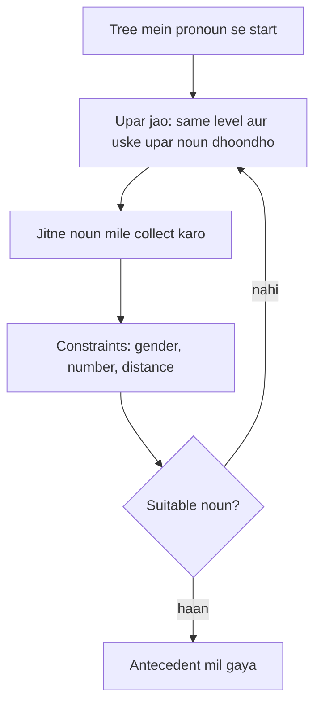

**In simple words:** Hobbs algorithm sentence ke syntactic tree pe upar chadhkar nouns collect karta hai aur gender, number aur distance se wo noun chunta hai jo pronoun ke liye fit ho. <Cite id="class-nlp-asol" loc="p. 3" />

**Definition:** Hobbs Algorithm is a heuristic method for pronoun resolution, developed by Jerry Hobbs in 1976. It finds to which noun a pronoun is referring. It uses the syntactic tree of the sentence and finds the solution by operations on that tree. Heuristic ek rule of thumb hai jo aam taur pe chalta hai par guaranteed nahi.

**Steps**

1. Tree mein pronoun se **start** karo aur upar jao. Same level aur uske upar wale level mein noun check karo.
2. Noun mile to use **consider** karo aur tree mein baaki nouns check karo.
3. Saare nouns dekhne ke baad **constraints lagao**: gender, number agreement aur pronoun se distance.
4. Suitable antecedent na mile to saare steps **repeat** karo. <Cite id="class-nlp-asol" loc="p. 3" />

**Example:** "John saw Mary, he greeted her." Tree mein pronoun *he* ke upar ke nouns **Mary** aur **John** hain. Gender, number aur distance constraints lagao. *he* male ke liye use hota hai aur John male hai, isliye John suitable candidate hai. Mary female hai, isliye reject. Akhir mein *he* **John** ko refer karta hai. <Cite id="class-nlp-asol" loc="p. 4" />

**Conclusion:** Hobbs' algorithm ek simple, syntax-based method hai jo parse tree se ek baar mein ek pronoun resolve karta hai.
