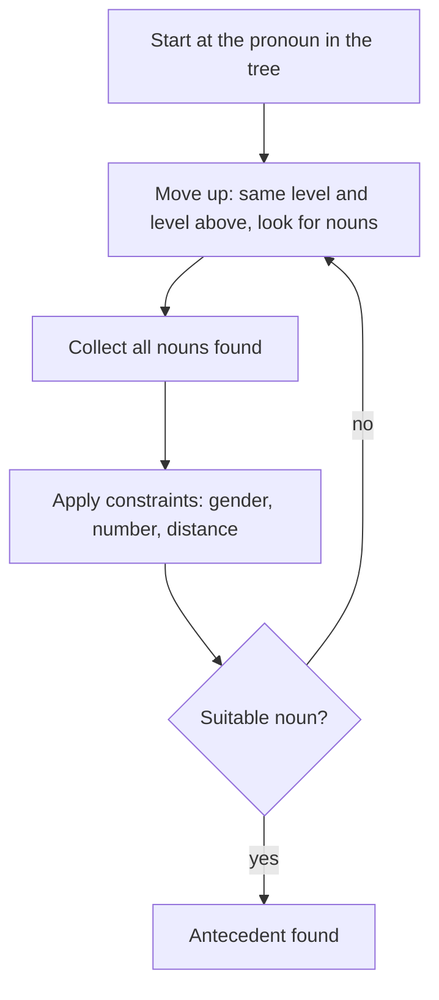

**In simple words:** the Hobbs algorithm finds the noun a pronoun refers to by climbing the syntactic tree of the sentence, collecting the nouns it meets and keeping the one that fits by gender, number and distance. <Cite id="class-nlp-asol" loc="p. 3" />

**Definition:** Hobbs Algorithm is a heuristic method for pronoun resolution, developed by Jerry Hobbs in 1976. It finds to which noun a pronoun is referring. It uses the syntactic tree of the sentence and finds the solution by operations on that tree. A heuristic is a rule of thumb that usually works but is not guaranteed.

**Steps**

1. **Start** with the pronoun in the syntactic tree and move upwards. Check the same level and the level above for a noun.
2. When a noun occurs, **consider it** and check for other nouns in the tree.
3. After considering all nouns, **apply constraints**: gender, number agreement and distance from the pronoun.
4. If no suitable antecedent is found, **repeat** all the steps. <Cite id="class-nlp-asol" loc="p. 3" />

**Example:** "John saw Mary, he greeted her." The nouns above the pronoun *he* in the tree are **Mary** and **John**. Apply the gender, number and distance constraints. *he* is used for a male and John is a male, so John is a suitable candidate. Mary is female, so she is rejected. Finally, *he* refers to **John**. <Cite id="class-nlp-asol" loc="p. 4" />

**Conclusion:** Hobbs' algorithm is a simple, syntax-based method that resolves one pronoun at a time from the parse tree.
