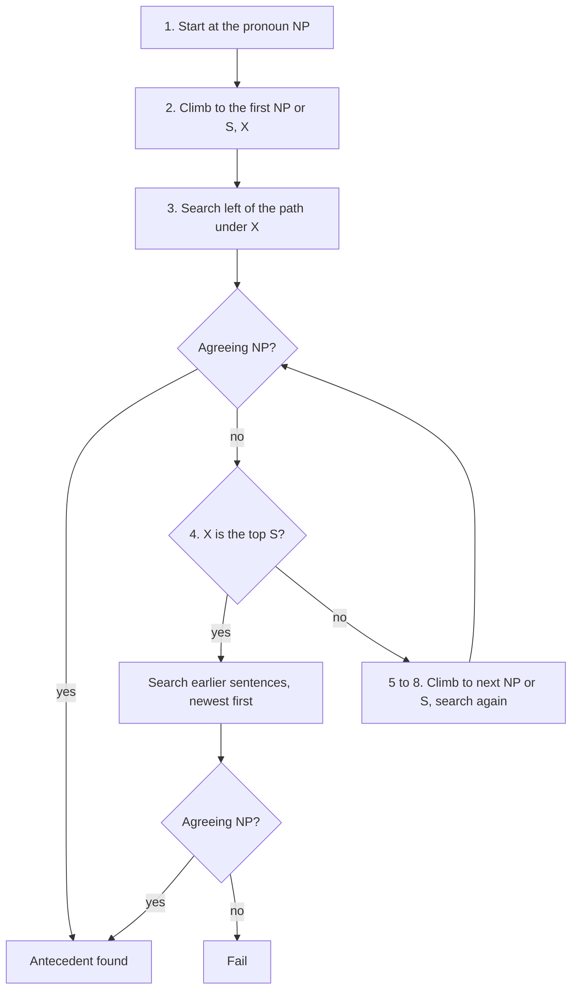

**In simple words:** a pronoun like *he* or *him* points back to an earlier noun phrase, its **antecedent**. **Hobbs' algorithm** (1978) finds it by walking over the **parse trees** in a fixed order: first the nearest places in the same sentence, then earlier sentences, newest first. The first noun phrase (NP) that agrees with the pronoun is the answer. <Cite id="anaphora-resolution-hobbs1978" /> <Cite id="anaphora-resolution-ibm-coref" />

**Why it is needed.** Machines must know who *he* is to understand a text, summarise it or translate it. Hobbs gives a simple rule-based method that needs no training data and was a strong baseline. <Cite id="anaphora-resolution-tetreault2001" />

**Terms.** *Breadth-first* means visit all nodes of one level before going deeper. *Agreement* means same number, gender and person.

**Algorithm:**

1. Begin at the NP node that dominates the pronoun.
2. Go up to the first NP or S node; call it X and the path p.
3. Search below X, to the **left** of p, left-to-right, breadth-first. Propose any NP that has another NP or S between it and X.
4. If X is the top S, search the **previous sentences**, most recent first, left-to-right, breadth-first, proposing every NP. Otherwise go to step 5.
5. Go up to the next NP or S node: the new X.
6. If X is an NP and p did not pass through the N-bar below it, propose X.
7. Search below X to the left of p, left-to-right, breadth-first; propose any NP.
8. If X is an S, search to the **right** of p (but do not go below any NP or S); propose any NP.
9. Go to step 4.

A proposal is accepted only if it agrees with the pronoun. <Cite id="discourse-reference-slp3-coref" />

<Sum>

<Given>

Text: *Sita met Ravi. She gave him a book.* Trees: [S1 [NP Sita] [VP met [NP Ravi]]] and [S2 [NP She] [VP gave [NP him] [NP a book]]]. Pronoun: *him* (masculine, singular, third person).

</Given>

<Find>

the antecedent of *him*.

</Find>

<Steps>

1. Start at NP(*him*). Climb: VP is not NP or S, so the first one is S2. X = S2.
2. Search left of the path under S2: only NP(*She*). Nothing lies between it and S2, so it is not proposed. *Reason: a pronoun cannot point to a noun phrase in its own clause.*
3. S2 is the top S, so go to S1 (the previous sentence).
4. Search S1 left-to-right, breadth-first. First NP: *Sita*. Agreement test: feminine, but *him* is masculine, so reject.
5. Next NP: *Ravi*. Masculine, singular, third person: agrees. Accept.

</Steps>

<Answer>

*him* = *Ravi*

</Answer>

<Box kind="verify">

Meaning check: *She gave him a book* with *him* = Ravi is natural. *Sita* is rejected on gender. For *She*, the same search reaches S1 and *Sita* agrees, so *She* = Sita.

</Box>

</Sum>

**Advantages:** simple, fast, no training, about 88% on Hobbs' own test of 300 pronouns. **Disadvantages:** needs a correct parse of every sentence; works only for pronouns; uses no meaning or world knowledge; picks the nearest agreeing NP even when wrong; later tests give lower scores. <Cite id="anaphora-resolution-tetreault2001" /> <Cite id="anaphora-resolution-tp-nlp" />

**Conclusion:** Hobbs' algorithm turns the grammar's recency and role preferences into a tree walk. It is a good baseline, but modern systems learn these cues from data.
