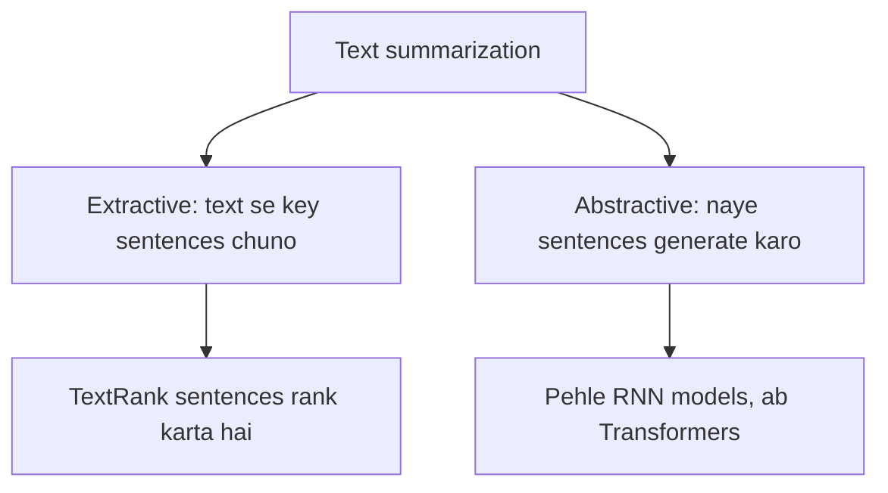

**In simple words:** text summarization lambe text ko chhota banata hai aur important information bachata hai. <Cite id="class-nlp-m6" loc="slide 23" /><Cite id="class-nlp-asol" loc="p. 12" />

**Definition:** summarization is a key technique in NLP that uses algorithms to reduce large texts while preserving essential information. Key concepts nikaalkar aur original meaning rakhkar ye systems banking, law aur healthcare mein faster decisions aur information retrieval mein madad karte hain.

**1. Extractive summarization** original text ke key passages chunkar aur jodkar summary banata hai. Ye sabse important sentences nikaalta hai, naya content nahi banata; goal meaning rakhkar text chhota karna hai. **TextRank** algorithm widely use hota hai: wo sentences ko relevance aur importance se rank karke concise summary banata hai. <Cite id="class-nlp-m6" loc="slide 24" /><Cite id="class-nlp-asol" loc="p. 13" /> TextRank kaise kaam karta hai ye class files mein nahi dikhaya. Short mein: text ko sentences mein todo, similar sentences ko graph mein jodo, har sentence ko score do ki wo kitna well connected hai, aur top sentences original order mein rakho.

**2. Abstractive summarization** key ideas batane ke liye bilkul naye sentences generate karta hai. Wo information ko zyada concise aur coherent rephrase karta hai, aksar naye words ke saath jo original mein nahi the. Ye Transformer models ke saath prominent hua; pehle recurrent neural networks (RNNs) pe based models use hote the. <Cite id="class-nlp-m6" loc="slide 25" /><Cite id="class-nlp-asol" loc="p. 13" />

| Point | Extractive | Abstractive |
|---|---|---|
| New sentences | nahi, original sentences copy | haan, naye likhta hai |
| Example method | TextRank | RNN, Transformer models |
| Vocabulary | original se | naya ho sakta hai |

**Applications:** banking, law aur healthcare, faster decisions aur information retrieval ke liye. <Cite id="class-nlp-m6" loc="slide 23" />

**Conclusion:** extractive summaries chunti hain, abstractive summaries rewrite karti hain; dono text chhota karti hain aur meaning rakhti hain.
