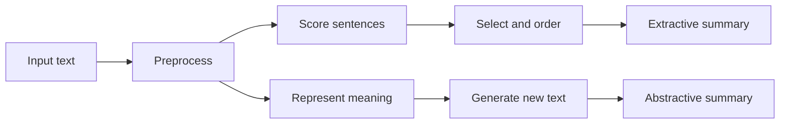

**In simple words:** **text summarization** lambe text ka chhota version banata hai jo important points rakhta hai. Reader ko main idea seconds mein mil jaata hai. <Cite id="nlp-applications-gfg-summ" /> <Cite id="ambiguity-challenges-wiki-summ" />

**Ye kyun zaroori hai.** Text (news, reports, reviews, papers) itna zyada hai ki koi sab padh nahi sakta. Summaries time bachati hain, search results mein madad karti hain aur doosre systems (news apps, legal aur medical reading) ko feed hoti hain.

**Types:**

| Basis | Types |
|---|---|
| Method | **Extractive**: best sentences chuno aur copy karo. **Abstractive**: text samjho aur naye sentences likho. |
| Input | Single-document ya multi-document |
| Purpose | Generic ya query-focused (sawal ka jawab deta hai) |
| Style | Indicative (kis baare mein hai) ya informative (text ki jagah leta hai) |

**Extractive summarizer ke steps:**

1. **Preprocess:** sentences aur words mein todo, stop words hatao, stem karo.
2. **Har sentence ko score karo** clues se jaise word frequency, tf-idf, position (pehle sentences important), title words, length, ya graph rank (TextRank). <Cite id="nlp-applications-av-textrank" />
3. **Rank karo aur select karo** top sentences, length limit tak.
4. **Order karo** original ke jaise taaki summary achhi padhe.

**Abstractive** system text ko neural encoder-decoder ya Transformer se encode karta hai aur nayi wording generate karta hai; ye zyada natural hai lekin facts invent kar sakta hai.

<Sum>

<Given>

S1 "NLP helps computers understand language." S2 "Computers use NLP to understand human language." S3 "The weather is nice." Score = content words ki word frequencies ka sum, content words ki sankhya se divide (stop words to, the, is hata diye).

</Given>

<Find>

sabse achha sentence.

</Find>

<Steps>

1. Word counts: nlp 2, computers 2, understand 2, language 2, aur helps, use, human, weather, nice 1-1.
2. S1 mein 5 content words: $2+1+2+2+2 = 9$, average $9/5 = 1.8$.
3. S2 mein 6: $2+1+2+2+1+2 = 10$, average $10/6 = 1.67$.
4. S3 mein 2: $1+1 = 2$, average $2/2 = 1.0$.

</Steps>

<Answer>

S1 sabse achha sentence hai (1.8), phir S2 (1.67), phir S3 (1.0).

</Answer>

<Box kind="verify">

Totals check karo: har word ka count guna uske occurrences $4+1+4+4+4+1+1+1+1 = 21$, jo $9 + 10 + 2 = 21$ ke barabar hai. Division ke bina S2 sirf lamba hone ki wajah se jeet jaata.

</Box>

</Sum>

**Evaluation.** ROUGE system summary ko human summaries se shared n-grams gin kar compare karta hai. <Cite id="nlp-applications-rouge" />

**Advantages:** time bachata hai, consistent. **Limits:** extractive summaries kharab padh sakti hain ya context miss kar sakti hain; abstractive galat ho sakti hain; evaluation mushkil hai.

**Applications:** news digests, search snippets, meeting notes, legal aur medical reports. <Cite id="pyq-2024-12-gfg-summ" />
