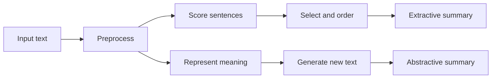

**In simple words:** **text summarization** produces a short version of a long text that keeps the important points. A reader gets the main idea in seconds. <Cite id="nlp-applications-gfg-summ" /> <Cite id="ambiguity-challenges-wiki-summ" />

**Why it is needed.** There is far more text (news, reports, reviews, papers) than anyone can read. Summaries save time, help search results and feed other systems (news apps, legal and medical reading).

**Types:**

| Basis | Types |
|---|---|
| Method | **Extractive**: pick the best sentences and copy them. **Abstractive**: understand the text and write new sentences. |
| Input | Single-document or multi-document |
| Purpose | Generic or query-focused (answers a question) |
| Style | Indicative (what it is about) or informative (replaces the text) |

**Steps of an extractive summarizer:**

1. **Preprocess:** split into sentences and words, remove stop words, stem.
2. **Score each sentence** with clues such as word frequency, tf-idf, position (first sentences matter), title words, length, or graph rank (TextRank). <Cite id="nlp-applications-av-textrank" />
3. **Rank and select** the top sentences up to the length limit.
4. **Order** them as in the original so the summary reads well.

An **abstractive** system encodes the text with a neural encoder-decoder or Transformer and generates new wording; it is more natural but can invent facts.

<Sum>

<Given>

S1 "NLP helps computers understand language." S2 "Computers use NLP to understand human language." S3 "The weather is nice." Score = sum of word frequencies of content words, divided by the number of content words (stop words to, the, is removed).

</Given>

<Find>

the best sentence.

</Find>

<Steps>

1. Word counts: nlp 2, computers 2, understand 2, language 2, and helps, use, human, weather, nice 1 each.
2. S1 has 5 content words: $2+1+2+2+2 = 9$, average $9/5 = 1.8$.
3. S2 has 6: $2+1+2+2+1+2 = 10$, average $10/6 = 1.67$.
4. S3 has 2: $1+1 = 2$, average $2/2 = 1.0$.

</Steps>

<Answer>

S1 is the best sentence (1.8), then S2 (1.67), then S3 (1.0).

</Answer>

<Box kind="verify">

Check the totals: each word's count times its occurrences is $4+1+4+4+4+1+1+1+1 = 21$, equal to $9 + 10 + 2 = 21$. Without the division S2 would win only because it is longer.

</Box>

</Sum>

**Evaluation.** ROUGE compares the system summary with human summaries by counting shared n-grams. <Cite id="nlp-applications-rouge" />

**Advantages:** saves time, consistent. **Limits:** extractive summaries can read badly or miss context; abstractive ones can be wrong; evaluation is hard.

**Applications:** news digests, search snippets, meeting notes, legal and medical reports. <Cite id="pyq-2024-12-gfg-summ" />
