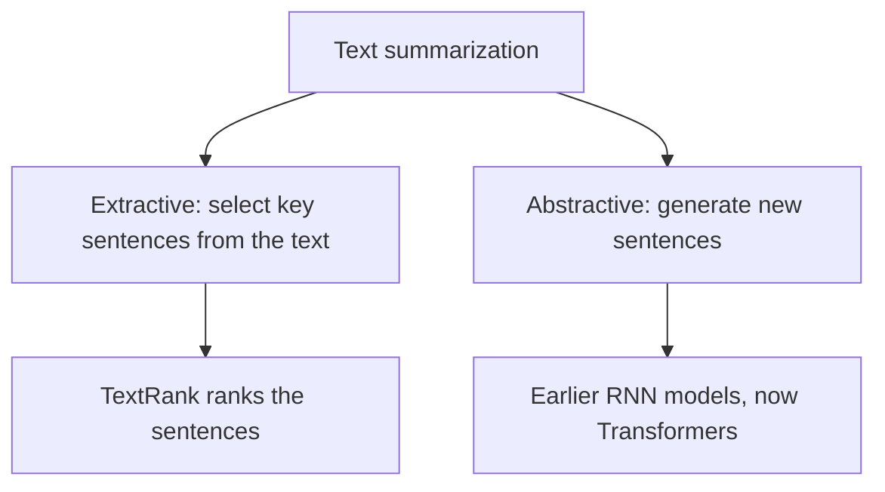

**In simple words:** text summarization makes a long text short while keeping the important information. <Cite id="class-nlp-m6" loc="slide 23" /><Cite id="class-nlp-asol" loc="p. 12" />

**Definition:** summarization is a key technique in NLP that uses algorithms to reduce large texts while preserving essential information. By extracting key concepts and maintaining the original meaning, these systems help banking, law and healthcare make faster decisions and retrieve information faster.

**1. Extractive summarization** automatically generates a summary by selecting and combining key passages from the original text. It extracts the most important sentences without creating new content; the goal is to keep the meaning while condensing it. The **TextRank** algorithm is widely used: it ranks sentences by relevance and importance and builds a concise summary. <Cite id="class-nlp-m6" loc="slide 24" /><Cite id="class-nlp-asol" loc="p. 13" /> How TextRank works is not shown in the class files. In short: split the text into sentences, join similar sentences in a graph, score each sentence by how well connected it is, and keep the top ones in their original order.

**2. Abstractive summarization** generates entirely new sentences to convey the key ideas. It rephrases the information more concisely and coherently, often with new vocabulary not found in the original. It gained prominence with Transformer models; earlier, models based on recurrent neural networks (RNNs) were used. <Cite id="class-nlp-m6" loc="slide 25" /><Cite id="class-nlp-asol" loc="p. 13" />

| Point | Extractive | Abstractive |
|---|---|---|
| New sentences | no, copies original sentences | yes, writes new ones |
| Example method | TextRank | RNN, Transformer models |
| Vocabulary | from the original | may be new |

**Applications:** banking, law and healthcare, for faster decisions and information retrieval. <Cite id="class-nlp-m6" loc="slide 23" />

**Conclusion:** extractive summaries select, abstractive summaries rewrite; both shorten text and keep the meaning.
