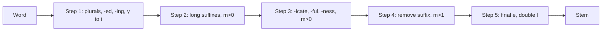

**In simple words:** **stemming** word ka ending kaat deta hai taaki related forms (*connect, connected, connecting, connection*) ek stem (*connect*) ban jaayein. **Porter stemmer** (Martin Porter, 1980) ye kaam suffix rules ke chhote set se paanch steps mein karta hai, bina dictionary ke. Stem real word hona zaroori nahi (*happy* ban jaata hai *happi*). <Cite id="porter-stemmer-def" /> <Cite id="text-preprocessing-porter1980" /> <Cite id="porter-stemmer-wiki-stem" />

**Ye kyun zaroori hai.** Search mein *connect* ki query ko *connected* bhi dhundna chahiye. Stemming vocabulary bhi chhota karti hai. <Cite id="porter-stemmer-gfg-stemming" />

**Measure m.** Letter vowel hai agar wo a, e, i, o, u hai, ya consonant ke baad aaya y; warna consonant. Har word ka form $[C](VC)^m[V]$ hota hai, jahan C consonants ka run aur V vowels ka run hai. Number $m$ VC pairs ginta hai: *tree* $m=0$, *trouble* $m=1$, *private* $m=2$. Rule tabhi chalta hai jab bacha hua stem kaafi lamba ho, jo $m$ se test hota hai. <Cite id="porter-stemmer-def" loc="§2" />

**Rule form:** (condition) S1 to S2: agar word S1 pe khatam hota hai aur stem condition satisfy karta hai, to S1 ko S2 se badlo. Ek group mein sirf **longest matching** S1 wala rule use hota hai.

<Cite id="porter-stemmer-snowball" loc="the steps" />

| Step | Kya karta hai | Example |
|---|---|---|
| 1a | Plurals: SSES to SS, IES to I, SS stays, S removed | caresses to caress, ponies to poni, cats to cat |
| 1b | (m>0) EED to EE; stem mein vowel ho to ED ya ING hatao, phir tidy (AT to ATE, BL to BLE, IZ to IZE, double letter to one, short word add E) | agreed to agree, hopping to hop |
| 1c | (stem mein vowel) Y to I | happy to happi |
| 2 | m>0: ATIONAL to ATE, IZATION to IZE, BILITI to BLE ... | relational to relate |
| 3 | m>0: ICATE to IC, ALIZE to AL, ATIVE, FUL, NESS removed | goodness to good |
| 4 | m>1: AL, ANCE, ER, IC, ABLE, ANT, MENT, ION (S ya T ke baad) ... hatao | allowance to allow, adoption to adopt |
| 5 | (m>1) final E hatao; (m>1, double L) ek L | probate to probat, controll to control |

<Sum>

<Given>

Words *generalizations*, *relational*, *hopping*, *happiness*.

</Given>

<Find>

original Porter rules se har ka stem.

</Find>

<Steps>

1. **generalizations.** 1a: S hata, *generalization*. 2: IZATION to IZE (stem *general* ka $m>0$), *generalize*. 3: ALIZE to AL (stem *gener*, $m=2$), *general*. 4: AL hata (stem *gener* ka $m=2>1$), *gener*. 5: final E nahi. Result **gener**.
2. **relational.** 1: koi change nahi. 2: ATIONAL to ATE (stem *rel*, $m=1>0$), *relate*. 3: koi rule nahi. 4: ATE ke liye $m>1$ chahiye lekin *rel* ka $m=1$ hai, to rehta hai. 5a: E hatao kyunki *relat* ka $m=2>1$. Result **relat**.
3. **hopping.** 1b: ING hatao (stem *hopp* mein vowel hai), *hopp*; clean-up: double consonant p ek ho gaya, *hop*. Aage ke steps kuch nahi karte. Result **hop**.
4. **happiness.** 1a: SS pe khatam, unchanged. 3: NESS hata (stem *happi*, $m=1>0$), *happi*. Result **happi**.

</Steps>

<Answer>

gener, relat, hop, happi.

</Answer>

<Box kind="verify">

NLTK ke original Porter mode se check: generalizations se gener, relational se relat, hopping se hop aur happiness se happi. Measure check: *gener* C V C V C hai to $m=2$; *rel* C V C hai to $m=1$.

</Box>

</Sum>

**Errors.** Over-stemming: *university* aur *universe* dono *univers* ban jaate hain. Under-stemming: *alumnus* aur *alumni* alag rehte hain. Stem non-word ho sakta hai.

**Advantages:** fast, simple, dictionary nahi, English search ke liye standard. **Disadvantages:** sirf English, crude errors, non-word stems. Behtar: lemmatization (dictionary) ya Snowball (Porter2). <Cite id="porter-stemmer-av-stemming" />
